# Zero Menu Time

**Play SPT without ever leaving the world.** Trade with traders in their own rooms on the maps, hand in quests over the counter, build and run your hideout behind a real door, sleep in your own bed, and save your game there. The main menu is down to four words, and the menus between raids are gone.

Client and server mod for **SPT 4.1.6**. Requires **[Vagabond](https://sp-mod.com/mod/2642/vagabond)** (the open-world mod), which provides where traders stand and how maps connect.

| | |
|---|---|
| 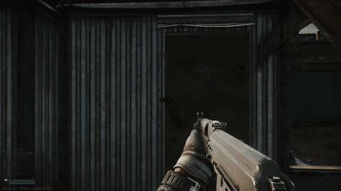 | 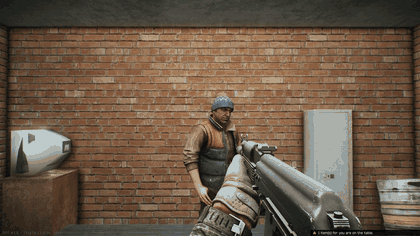 |
| 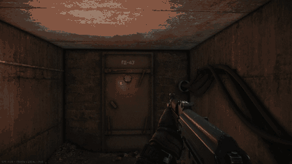 | 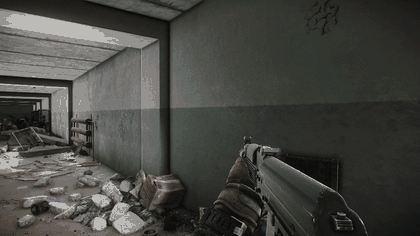 |


| | |
|---|---|
| 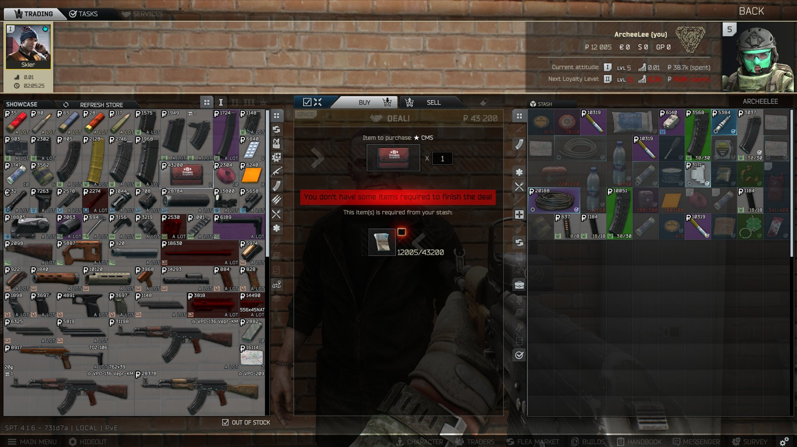 |  |
| 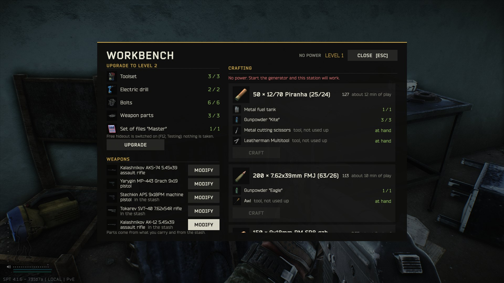 | 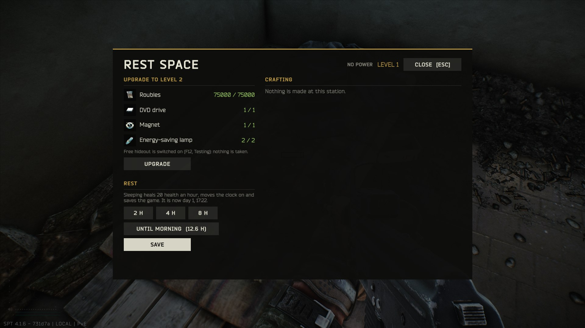 |

---

## What it does

### Traders live on the maps

- Every trader has a **door** at their spot on the map. Through it is the trader's **own room**, furnished in their style (Prapor's armoury, Therapist's clinic, Skier's den, Jaeger's cabin, ...). Bots cannot follow you in.
- Inside, talk to the trader: **Trade**, **Collect deliveries**, **Wait until morning** (costs food and water, as sleep does), **Save**, **Save and go to menu**.
- Trades are paid from what you carry, and what you buy is **laid on the trader's table**, to pick up by hand. The stash is not involved.
- You can **sell what you wear** as well as what you carry: a slung rifle, a holstered pistol, a helmet, armour. It comes off you when sold. A pack, rig or case is only offered once it is empty, the secure container never, and the weapon in your hands is left out.
- **Quests** are accepted and handed in at the trader. Items a quest gives when you accept it, and the **reward items** when you hand it in, are **laid on the table** in front of you; experience and standing follow when the raid ends.
- Mail from traders (quest rewards, insurance returns) waits **on the table**. Anything you leave there is still there next time.
- If you own the 1.0 game, the traders are their **real models** and **speak a line** when you start to trade. See [Real trader models and voices](#real-trader-models-and-voices).
- Every trader stocks a few **field supplies** (basic meds, food, water, a surgical kit) and the **map of the area they stand in**, so you are never stranded.

### One hideout, behind real doors

- The game's own hideout, loaded into the raid, behind an existing door on **Streets**, **Customs** and **Shoreline**. All three doors lead to the same hideout.
- Stations open a **window** showing what the next level needs (and how much you have, with item pictures), what they can make, from what, and how long it takes.
- **Build anything in any order**: no station, loyalty or skill requirements, and construction is instant. You still pay the materials.
- **Crafting**, timed on the world clock: crafts keep running while you are away, asleep, or on another map. Long recipe lists can be narrowed: buttons for what you can make now and for each kind of product, and the list narrows as you type a name.
- **Power**: fuel the Generator and switch it on. Without power the lights go out, crafts pause, and the bitcoin farm stops. Lamps (candles, bulbs, fluorescent) are fitted from the Generator's window.
- **Bitcoin farm**, **Water Collector** with filters, **Solar Power**, **Scav Case**, **Cultist Circle**, **Gym** workouts, **Shooting Range** controls.
- **Weapon modding** at the Workbench with the game's own modding screen, vital parts included, using parts from your gear and the stash.
- **Weapon Stand, Place of Fame, Equipment Stand** hold and display what you put on them.
- **Stash** in the hideout, with a **Sort stash** choice on the Stash station. Things sent between maps by the BTR driver arrive there.
- **Repair kits** work on what you carry: right-click a weapon or armour piece and choose **Repair** for the game's own repair window. The kits counted are those you carry, and those in the stash while you are in the hideout. As in the menus, weapons need the Workbench built and armour the Lavatory. Traders do not repair yet.
- **Sealed cases** (the weapon case of an airdrop, locked crates once unlocked) can be unpacked in the hideout: right-click the case and choose **Unpack**. What was inside goes into the stash. A locked case with its key, a sealed box or a locked supply crate is first opened at the **Workbench** (under CRATES).
- While you are inside, the hideout's stations **heal and feed you** at the game's own bonus rates, and every bot on the map is paused. The map's outdoor sounds are hushed down there, and the game's own **Hideout volume** setting applies.

### Time, sleep and saving

- **One world clock**. The time of day carries on from raid to raid, and **raids have no time limit**.
- **Sleep** at the Rest Space: the clock jumps, you heal, and you get hungry and thirsty as if the hours had passed.
- **Save** at the bed (sleeping saves too), or at a trader with **Save** (the raid goes on) or **Save and go to menu**. If you die, your **last save** is put back: you wake at your bed, or continue at the trader you saved at, with the gear, health, skills, quests, hideout and clock of that save. If the game stops mid-raid after a bed save, you wake at your bed.
- Want deaths to hurt? Set **When you die** to lose the gear you carried (the secure container is kept) or everything, the secure container too. The save still puts back skills, quests, the hideout and the clock; what you keep in the hideout is never lost.

### A menu of its own

- The main menu is **Continue / Reset / Settings / Guide / Exit** over a live view of your own hideout. Under Continue it says where and when you will pick up.
- **Continue** starts a raid where your character is.
- A **guide** in ten short steps opens when the game starts: where the first trader is, trading, the hideout, building, crafting, repairs, the real trader models, and a choice of what a death takes. Tick **Don't show again** to switch it off; **Guide** in the menu opens it at any time.
- A **new character** gets the same start as Reset, without asking.
- **Reset** starts over, keeping a backup of the old character: you wake in the hideout by its Customs door with a pistol and three magazines, soft armour, a rig, a backpack, medicine, water, food, and the Alpha container with 30,000 roubles.
- Result screens after a raid are skipped and the next raid starts by itself (hold Backspace to stay in the menu).

### Extras

- With **Dynamic Maps**, the hideout and trader doors of the map you are on are marked on its map.
- **F11** takes a clean picture without the interface; **F9** hides the interface.

---

## Where the doors are

Every door is one of the map's own doors. With [Dynamic Maps](https://sp-mod.com/mod/1431/dynamic-maps), the doors of the map you are on are also marked on its map (a door with a key; hideout doors in gold).

| Door | Map | Where |
|---|---|---|
| Skier | Customs | The trailer door just north of the Crackhouse, between the Crackhouse and the Repair Shop |
| Hideout | Customs | The ZB-1011 bunker on the east edge, past Warehouse 7: down the stairs, the steel door at the end of the tunnel |
| Prapor | Streets | First floor of the building by the Beluga restaurant on Primorsky Ave., the grey office door |
| Fence | Streets | The red door at the end of the alley between the Post Office and Cardinal Bank |
| Hideout | Streets | Under Prapor's building, the dark red double door at the end of the covered walkway |
| Ragman | Interchange | Parking garage, section C, below Avokado: the white door in the end wall |
| Jaeger | Woods | The stone bunker in the rock face between the Lumber mill and the Crash Site |
| Mechanic | Factory | Basement, by the caged electrical room: the door in the corridor wall |
| Therapist | Ground Zero | TerraGroup building by the Science Offices, 2nd floor, end of the corridor, next to the big 2 |
| Peacekeeper | Shoreline | The gate of checkpoint 11, at the west end of the map |
| Hideout | Shoreline | The gate of checkpoint 11 again: its right-hand half, under the canopy behind the barriers |
| Fence | Lighthouse | The drug lab: the shipping container doors behind the plant tables |

<details>
<summary>Pictures of every door</summary>

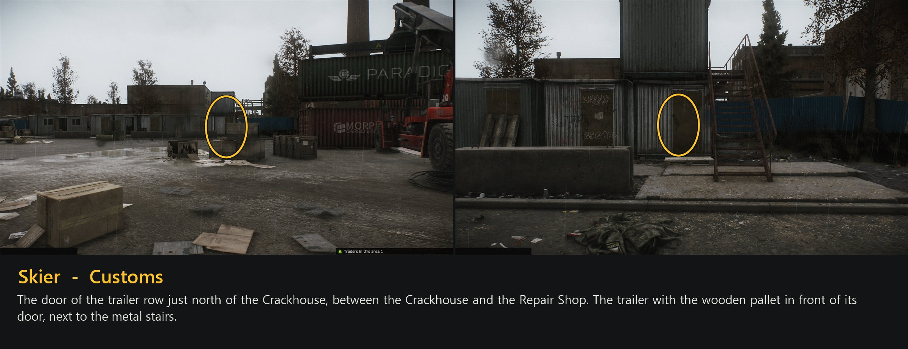
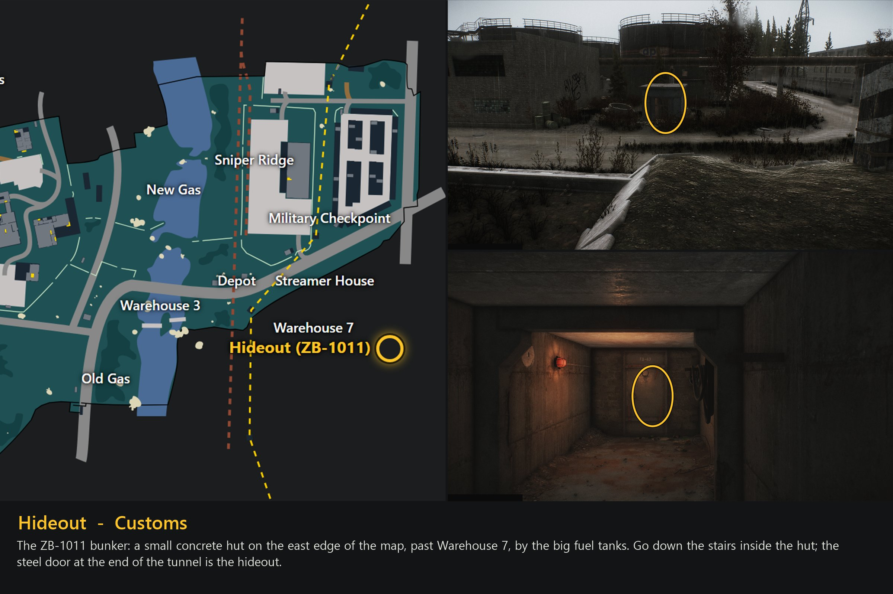

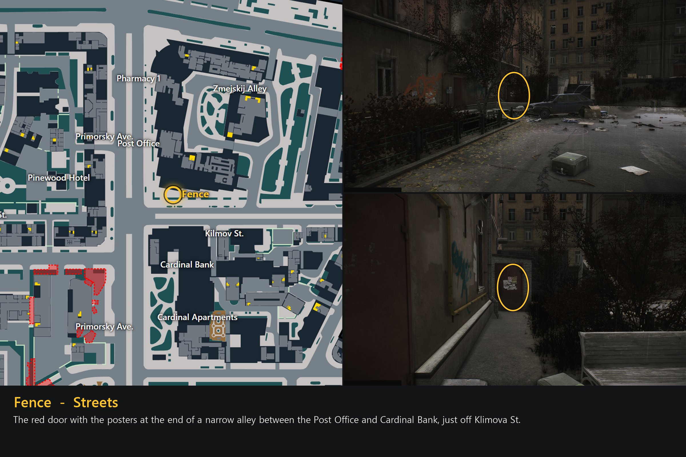

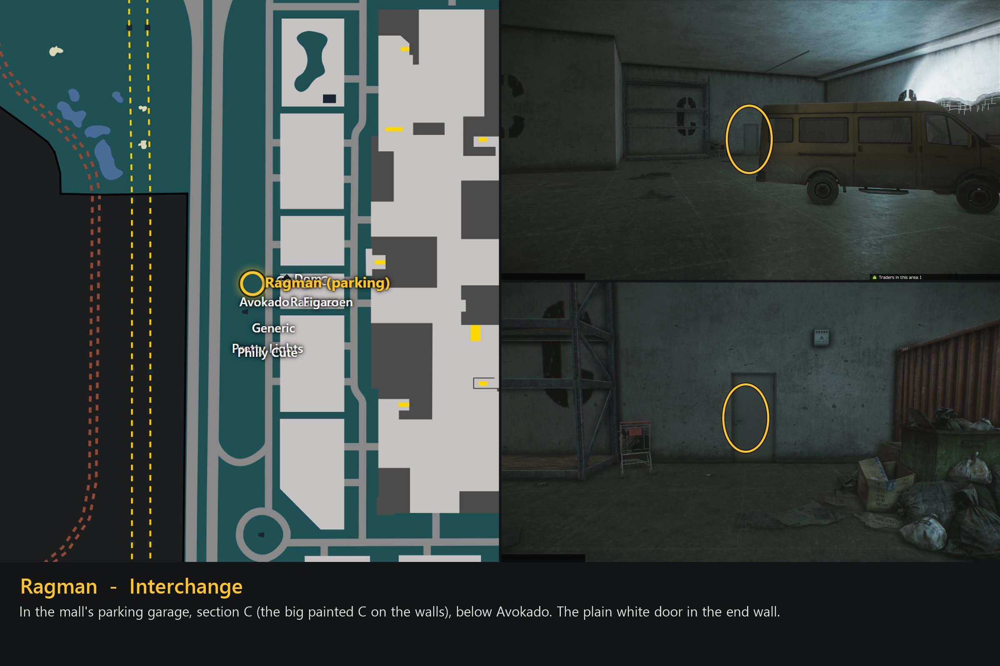
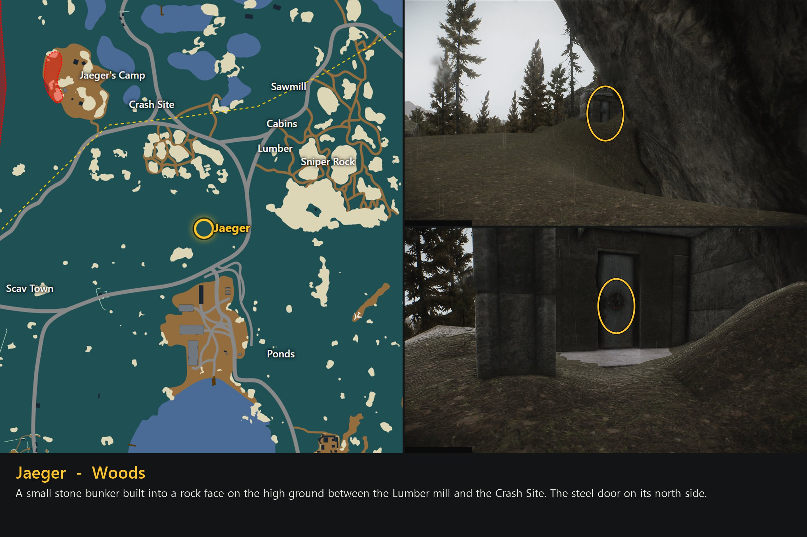

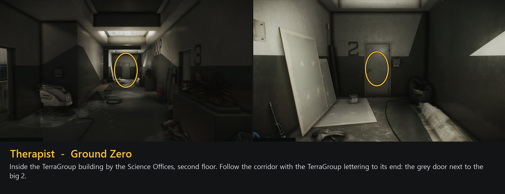


</details>

---

## Real trader models and voices

Seven traders (Prapor, Therapist, Skier, Mechanic, Ragman, Jaeger, Fence) can stand in their rooms as their **real models from the 1.0 game** and say one of their own lines when you open trade.

**This mod does not contain those models or voices, and never will.** They belong to the makers of the game, so they are not in the download. The mod reads them, when a raid starts, from **your own installed copy of the 1.0 game**:

- **If you own the 1.0 game and it is installed**, there is usually nothing to do: the mod finds it by itself.
- **If the models do not show up**, tell the mod where the game is: press **F12** in game, open **r2rka1-ZeroMenuTime → Trader models → Folder of the 1.0 game**, and enter the folder the 1.0 game is installed in (the one that holds the game's `.exe`). This is needed when the game was installed through Steam, or was moved or copied by hand. The change applies from the next raid.
- **If you do not own the 1.0 game**, nothing is missing or broken: the traders are stand-in figures as before, and they do not speak.

The folder of the 1.0 game is only read. Nothing in it is changed, and nothing from it is copied.

Peacekeeper has no model or voice of this kind in the 1.0 game and stays a stand-in figure. The voice lines are in Russian.

## Requirements

| Mod | | Version tested |
|---|---|---|
| **SPT** | required | 4.1.6 |
| **[Vagabond](https://sp-mod.com/mod/2642/vagabond)** | required | 0.8.3 |
| [UI Fixes](https://sp-mod.com/mod/1342/ui-fixes) | optional, supported | 6.0.4 |
| [Dynamic Maps](https://sp-mod.com/mod/1431/dynamic-maps) | optional, supported | 1.2.1 |
| Your own installed copy of the 1.0 game | optional: only for the real trader models and voices | 1.3.0 |

**Fika** (multiplayer) is **supported**, on a player's own game or a headless host: join a friend's raid at any time, share the host's hideout and stash, revive fallen teammates. It needs the small add-on zip next to the main one. See [Playing with friends](docs/coop.md).

## Install

1. Install SPT 4.1.6 and Vagabond first, and start the game once with Vagabond.
2. Extract the Zero Menu Time zip **into your SPT folder** (the one that holds the game's `.exe`). It adds:
   - `BepInEx/plugins/ZeroMenuTime/` (client)
   - `SPT_Runtime/user/mods/ZeroMenuTime/` (server)

   If your SPT server lives in a folder of its own, put `BepInEx/plugins/ZeroMenuTime/` in the game folder and `ZeroMenuTime` in the server's `user/mods/`, beside Vagabond.
3. Start the SPT server, then the game.
4. Make a new character as usual. It starts with the small starting kit and wakes in your hideout at Customs.
   With a character you already have, choose **Reset** in the main menu for the same start: the game closes; start it again and choose **Continue**.

Reset keeps the old character in `SPT_Runtime/user/profileData/<profile id>/newgame-backups/`. To remove the mod, delete the two folders above.

---

## How it works with other mods

**Vagabond (required).** Zero Menu Time is built on top of Vagabond's open world:

- Traders stand at Vagabond's trader extracts, read from its `trader_locations.json`. Change those and the trader rooms follow.
- After a death, Zero Menu Time puts your save back and wakes you at your bed. This replaces Vagabond's death handling while a save exists; before your first save, Vagabond's own rules apply. The mod's "Ask where to continue" setting covers the case without a save.
- Recommended Vagabond settings (`SPT_Runtime/user/mods/Vagabond/config/vagabond.json`):
  - `"LimitTraderMailAccess": false`, so trader mail can be collected at any trader's table.
  - `"EnableVirtualStashes": false`. Zero Menu Time has one hideout stash of its own; Vagabond's per-location stashes would swap it out depending on where you extracted.

**UI Fixes (supported).** Its in-raid weapon modding rule ("Modify Raid Weapons") is lifted inside the hideout, so the Workbench works as in the old menus. Everywhere else UI Fixes behaves as configured.

**Dynamic Maps (supported).** Door markers are added to its map at run time. Without it, nothing changes.

**Bot mods (SAIN, QuestingBots, Looting Bots, BigBrain, Waypoints, bot placement mods).** Played and tested alongside these. Bots are paused while you are in the hideout and resume where they stood. Over very long raids bots may thin out, because spawn waves are timed for normal raid lengths.

**Things this mod changes on the server.** Mods that change the same things may conflict:

- **Raid time limit:** every map's limit is set very high, because raids have no time limit.
- **Hideout data:** requirements for other stations, trader loyalty and skills are removed; construction time is zero.
- **Trader assortments:** a small stock of field supplies and local maps is added.
- **Quest rewards** handed in during a raid are paid to the trader's table.

**Likely to conflict:**

- Other in-raid trader mods.
- Main menu replacers.
- Mods that rewrite hideout production or hideout requirements.
- Mods that remove or replace the raid timer.
- Mods that change how energy and hydration drain. Zero Menu Time slows hunger and thirst as they run low; switch "Slow hunger and thirst as they empty" off if another mod handles this.

**Other mods in the test setup:** Realistic Insurance, Kirisame Med Timing, Dynamic Item Weights, Pause, HollywoodFX, Hollywood Graphics, ODT Item Info, Restore the Old Number of Medical Uses. No problems seen with these.

---

## Settings

Press **F12** in game and open **r2rka1-ZeroMenuTime**.

| Section | Setting | Default | What it does |
|---|---|---|---|
| General | Show trader figures | on | Stand a figure for each trader |
| General | Show trader markers | on | Show a box at a trader spot until its figure has loaded |
| General | Also use traders.json spots | off | Add hand-placed trader spots on top of Vagabond's |
| General | Show the guide at start | on | Show the guide over the main menu when the game starts |
| General | Remove the hideout exits of Vagabond | on | Switch off Vagabond's own exits to its menu hideout, which serve no purpose with this mod's hideout |
| General | Capture position key | F10 | Write your position to `captured_positions.txt`, for placing doors and spots |
| Trader rooms | Put traders in rooms | on | Off: traders stand in the open and deliveries go straight into your gear |
| Trader rooms | Furnish rooms from the game | on | Off: plain rooms |
| Trader rooms | Room depth below the door | 300 | How far under the map the rooms are built, in metres |
| Trader models | Use the real trader models | on | Stand the traders' own models in their rooms, read from your own installed copy of the 1.0 game |
| Trader models | Folder of the 1.0 game | empty | Where your copy of the 1.0 game is installed. Empty: the mod finds it by itself. Fill it in if the models do not show up |
| Trader models | Trader voices | on | A trader says a line of their own when you start to trade. Needs your own copy of the 1.0 game |
| Trader models | Voice volume | 0.8 | How loud the traders speak |
| No menus | Enabled | on | Skip result screens and continue automatically |
| No menus | Seconds before continuing | 4 | Countdown in the main menu |
| No menus | Stay in menu key | Backspace | Hold during the countdown to stay in the menu |
| Death | Ask where to continue | on | Without a save, ask whether to continue at the hideout or where you died |
| Death | When you die | KeepItems | KeepItems: the save is put back with its gear. LoseCarriedGear: what you carried is lost, the secure container is kept. LoseEverything: the secure container is emptied too |
| Metabolism | Slow hunger and thirst as they empty | on | Food and water drain more slowly as they run low |
| Pictures | Take a picture key | F11 | Save the view without the interface to `BepInEx/plugins/ZeroMenuTime/screenshots` |
| Pictures | Hide the interface key | F9 | Hide the interface until pressed again |
| Pictures | Hide the interface in pictures | on | Off: pictures include menus and windows |
| Pictures | Picture size | 2 | Saved picture size, in multiples of the screen |
| Testing | Undying, Free hideout, Self-test key, Test harness | off | For development only |

### Moving traders, and traders of other mods

Each trader has a group **Trader - NAME** with a **Map** and a **Door**; a trader added by another mod gets **Custom trader -
NAME** with **Map**, **Door**, **Room** and **Figure**, and is on no map until you place them. The doors to choose from are
doors the maps already have that cannot be opened, have nothing behind them and no way out of the map at them. How it works, and
every door with a picture: **[docs/trader-places.md](docs/trader-places.md)**.

| Section | Setting | Default | What it does |
|---|---|---|---|
| Trader - NAME | Map | where Vagabond has them | The map the trader is on |
| Trader - NAME | Door | the door picked for them | The door on that map; arrows go through the map's doors |
| Custom trader - NAME | Map | Not placed | The map a trader of another mod is on |
| Custom trader - NAME | Door | the first free door | Their door on that map |
| Custom trader - NAME | Room | Plain | Plain, or furnished like one of the game's traders' rooms |
| Custom trader - NAME | Figure | Fence | Whose figure stands in the room |
| Saving | Save after travelling to another map | off | Saves each time you arrive on another map, at the way in you came by |

### Placing doors yourself

Every trader door is placed on a real door of the map (see "Where the doors are"). A trader added at a new spot gets a door against the nearest building wall. To move one:

1. Stand with your back to the door you want, and press **F10**.
2. Copy the line from `BepInEx/plugins/ZeroMenuTime/captured_positions.txt` into `doors.json` in the same folder (a list), and fill in the trader's id.

Hideout doors can be moved the same way in `hideouts.json`.

---

## Known limits

- Rooms are bare for about half a minute after a raid starts, while their furniture is fetched. Using a door earlier waits behind a dark screen until it is ready.
- Only the backpack (or the rig) is offered for selling; payment and purchases use everything you carry.
- Barter trades paid with items do not count toward trader loyalty.
- Air filters and the Equipment Stand's outfits are not built.
- With **When you die** on KeepItems, gear lost in a death is still reported to insurance, so insured items can come back twice after the save is restored.
- If the game crashes after a quest hand-in, the reward items you picked up are kept although the quest is not recorded as done.
- Without your own copy of the 1.0 game, trader figures are stand-ins dressed in the game's own clothing, and they do not speak.
- The 1.0 game is found only where Windows says it is installed. A Steam install, or a copy moved by hand, has to be entered in the setting.
- Post-raid healing is skipped along with the other result screens.

---

## Building from source

Needs the .NET 10 SDK and an SPT 4.1.6 install to reference.

```
dotnet build ZeroMenuTime/ZeroMenuTime.csproj -c Release -p:GameDir=C:\path\to\SPT\
dotnet build ZeroMenuTime.Server/ZeroMenuTime.Server.csproj -c Release -p:GameDir=C:\path\to\SPT\
```

- The server project references `Vagabond.Common.dll` from the Vagabond server mod folder.
- The fallback room bundle is built with Unity 2022.3.43f1 from `Unity/TraderRooms`; see its README. It is made only from simple shapes and generated textures, with no game assets.
- `pack.ps1` builds everything and writes the release zip to `dist/`, laid out to extract into the SPT folder, with this README and the licence.

The development test harness (Testing → Test harness) runs commands from `BepInEx/plugins/ZeroMenuTime/test/commands.txt` in a running raid; see `ZeroMenuTime/TestHarness.cs` for the commands.

## Credits

- Built on [Vagabond](https://github.com/MrEliasen/SPT-Vagabond) by Oogabooga.
- The in-raid trading idea follows Lillian's In-Raid Traders for SPT 3.11; this is a separate implementation.
- Written with the help of an AI coding assistant (Claude), then played and tested by hand.

## Licence

[MIT](LICENSE)
