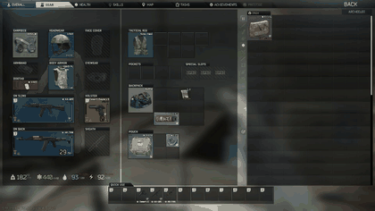
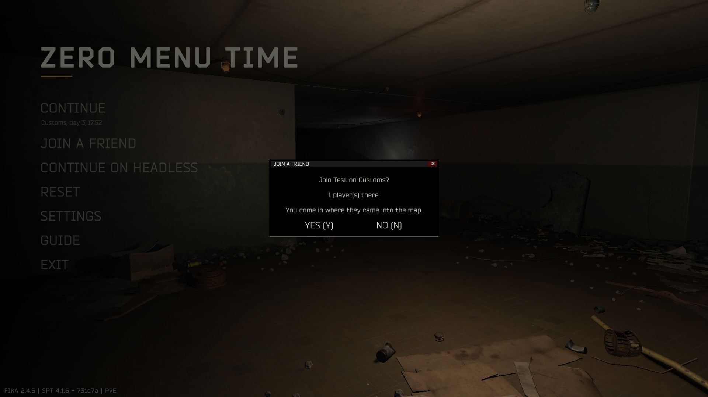
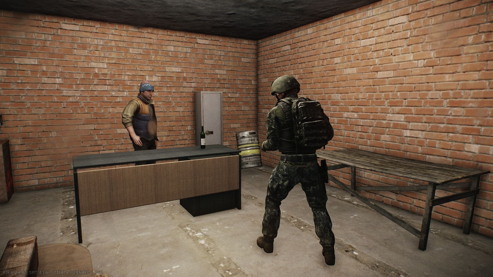
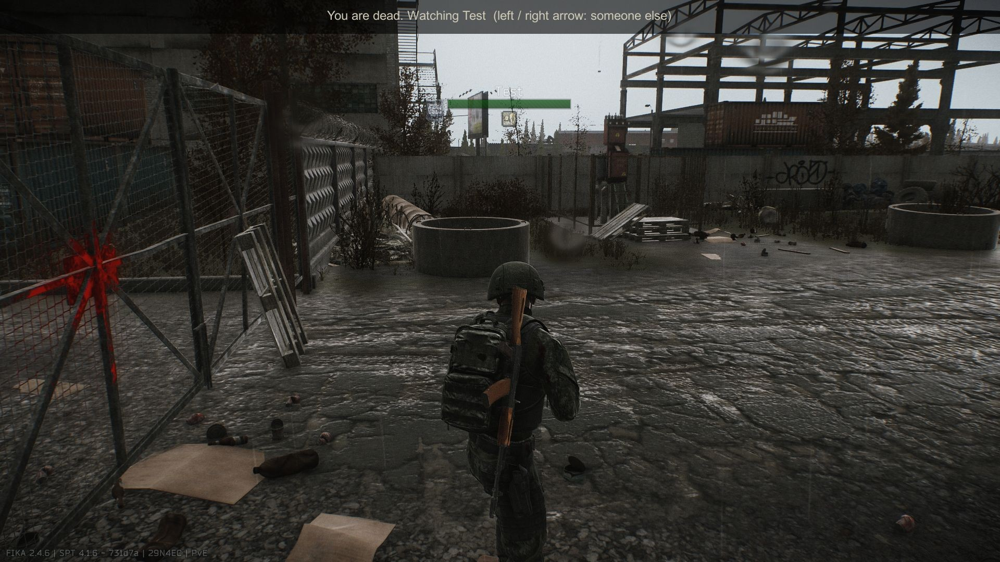
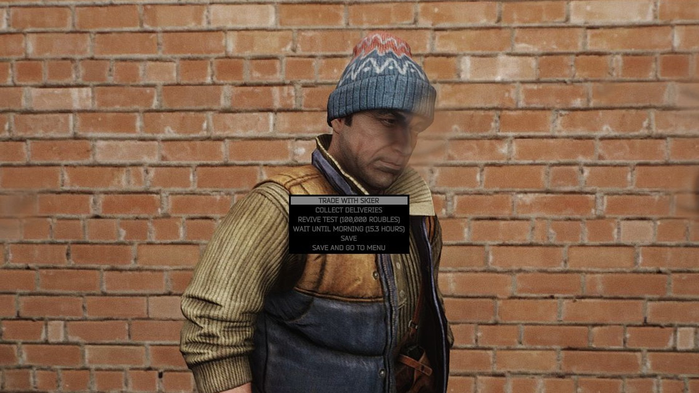
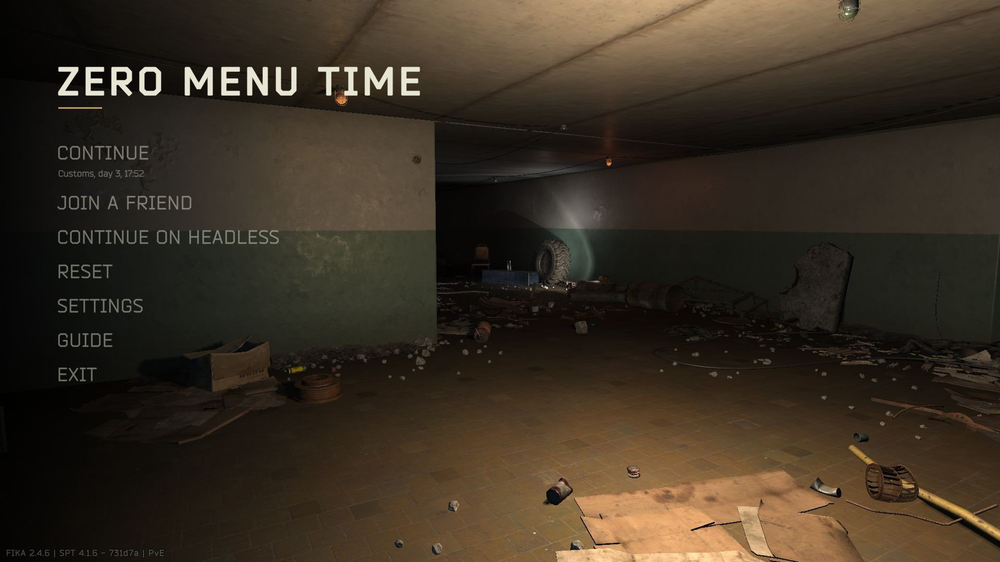
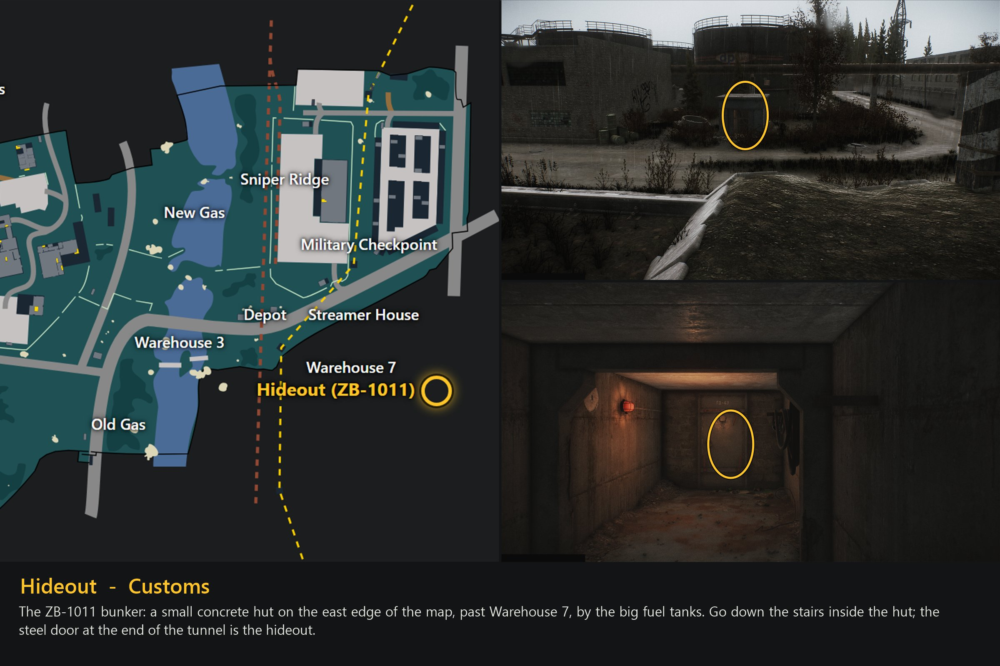

**Play SPT without ever leaving the world, alone or with friends.** No menus between raids: you trade in the traders' own rooms on the maps, hand in quests over the counter, build and run your hideout behind a real door, sleep in your own bed, and the next raid starts where you stood.

**New in 2.0: play it with friends.** Fika and headless hosts are supported: join a friend's raid at any time, share one hideout and one stash, and bring fallen teammates back. See the **Playing with friends** and **Headless host** tabs. Alone, it plays as before.

Needs **[Vagabond](https://sp-mod.com/mod/2642/vagabond)**. Report bugs in the **Issues** tab above, with your `BepInEx/LogOutput.log`.

| Walk in and trade | Your purchase is on the table |
|---|---|
|  |  |
| **The hideout is behind a door** | **Build and craft in first person** |
|  |  |

## Zero Menu Time {.tabset}

### Overview

- **Traders live on the maps.** Each has a door on one map, and a room of their own behind it. Nothing can follow you in.
- **Trade, quests and mail at the trader.** You pay from what you carry. What you buy, quest rewards and deliveries are laid on the table to pick up by hand.
- **One hideout, three doors** (Customs, Streets, Shoreline). Build stations, craft, run the generator, mod weapons, repair, use the stash, all in first person.
- **One world clock, no raid timer.** Sleep in your bed to pass time, heal and save.
- **A menu of its own**: Continue, Reset, Settings, Guide, Exit, over a live view of your hideout.
- **A guide at start** walks you through all of it in a minute.
- **With friends**, through Fika: one world for the group, joined at any time. Dying does not end the raid; teammates can revive you.

### Traders

- Walk up to a trader's door, look at it and choose **Enter**.
- Inside: **Trade**, **Collect deliveries**, **Wait until morning**, **Save**, **Save and go to menu**.
- What you buy is **laid on the table**. Quest rewards, the items a quest gives at the start, insurance and other mail arrive there too. Anything you leave waits for your next visit.
- **Sell what you carry or wear.** A slung rifle or a worn helmet comes off you when sold. A pack, rig or case is only offered once empty; the secure container never.
- Quests are taken and handed in in the trader's **Tasks** tab.
- Every trader stocks a few field supplies and the map of the area they stand in.

**Real trader models and voices.** Seven traders can stand in their rooms as their real models and say a line when you start to trade. **The mod does not contain those models or voices**: they belong to the makers of the game. It reads them from **your own installed copy of the 1.0 game**.

- Own it and have it installed? Usually there is nothing to do.
- Models do not show? Press **F12**, open **r2rka1-ZeroMenuTime → Trader models → Folder of the 1.0 game** and enter the folder it is installed in. Needed for a Steam install or a copy moved by hand.
- Do not own it? Nothing is missing: the traders are stand-in figures and do not speak.

### Hideout

- Behind an existing door on **Customs**, **Streets** and **Shoreline**. All three lead to the same hideout. While you are inside, the raid above stands still (with friends: once everyone is indoors).
- Look at a station and open its **window**: what the next level needs, what it can make, how long it takes. Build in any order; you pay the materials.
- **Power**: fuel the Generator and switch it on. Without it the lights are out and crafts wait.
- **Crafting** runs on the world clock, also while you raid or sleep. Filter the recipe list by kind, by what you can make now, or by typing a name.
- **Workbench**: the game's own weapon modding screen.
- **Repair kits**: right-click a weapon or armour piece → Repair. Weapons need the Workbench, armour the Lavatory.
- **Sealed cases** from airdrops: right-click → Unpack while in the hideout; the contents go to the stash. Locked cases, sealed boxes and locked crates are opened at the Workbench first.
- **Stash** with a Sort choice. **Rest Space**: sleep, heal, save.
- Bitcoin farm, Water Collector, Solar Power, Scav Case, Cultist Circle, Gym, Shooting Range, Weapon Stand, Place of Fame.

### Playing with friends

Works with **[Fika](https://sp-mod.com/mod/2326/project-fika)**. Alone, nothing here applies and nothing changes. This is the first co-op release: **back up your profiles**.

**Starting**

- **Continue** hosts your world on your own game. It starts at once; there is no waiting room.
- **Join a friend** lists the raids that are running and brings you into the one you pick, **at any time**. You arrive beside the group. Doors already opened, bodies and things lying about are there for you too.
- A game that crashes or is closed can come back into the same raid the same way.

**One world, and it is the host's**

- Everyone sees the same trader rooms, the same doors and the same clock, and walks in and out on their own.
- **The raid stands still only while every living player is indoors** (a trader's room or the hideout). One player at a trader does not stop the world for the others.
- **The hideout** is the host's: their stations, their generator, their crafts. Only the host builds; everyone uses it.
- **One stash**, the host's. Everyone can put in and take out. **What is in it when the raid ends belongs to the host.**
- **Sleeping** and **waiting until morning** ask everyone: a question on screen, **Y** or **N**, thirty seconds. All yes, and time moves on for all.
- Trading, deliveries and quests are your own. What you buy, and what you are paid, is laid in the room, where anyone can pick it up.

**Dying is not the end of the raid**

- Die while a teammate lives and the raid goes on. Everything you carried lies where you fell; your secure container, armband, knife and dog tag stay with you.
- You **watch your teammates**: left and right arrow change whom.
- A teammate can **revive** you at any trader for **100,000 roubles**, or **for free** at the hideout's medical station. You come back where the group came into the map, hurt and hungry, with nothing. Your gear is where you left it.
- When the **last** living player dies or leaves, the raid is over for everyone, and each player's own **When you die** setting applies.
- If the group takes a **transit** while you are dead, you come to life on the new map, with your **When you die** setting applied there.

| Watching a teammate | Revive at a trader |
|---|---|
|  |  |

**What to install**

On **every** player's game:

1. Zero Menu Time, as in the **Install** tab.
2. The add-on **`ZeroMenuTime-Fika`** (a second small zip on the same download page), extracted into the same folder. **Only where Fika is installed.**
3. The **same version** of Zero Menu Time for everyone. A player on another version is told so and kept out of the rooms for that raid.

On the server: Fika's server mod, and this mod's server part (it is in the main zip). In Fika's settings leave its own **revive** option **off**: this mod has its own.

Tested with Fika 2.4.6 (server mod 2.4.2).

**Good to know**

- If you host on your own game you cannot leave while others are in your raid: **Save and go to menu** asks whether to end the raid for everyone. On a headless host anyone can leave.
- With a dead teammate, a transit refuses whoever uses it before the dead one has been brought there. A notice says so; use it again.
- With *Keep items*, gear can be doubled through a transit: your pile stays where you fell, and your saved gear is given again on arrival.
- The shared stash cannot be sorted in co-op.
- Something laid down for everyone appears for the others a moment later. Leave it a second before picking it up.
- Not tried together with other mods that change **joining a raid in progress** or **what happens when you die** in Fika (late-join and downed or revive mods). This mod does both itself; use one or the other.
- Tested by its author with two players and a headless host on one machine. Larger groups and play over the internet are new ground: reports are welcome.

### Headless host

A **headless host** is a copy of the game with no picture and no player, which runs the raid for the group. With one, nobody's own game has to stay in the raid: **anyone can save, leave and come back while the others play on.**

**How it plays**

- Choose **Continue on headless** in the main menu. A free headless host starts a raid for you where you are, and you are in it as soon as it has loaded.
- **The world is yours**, as if you hosted it yourself: your clock, your hideout, your stash. Friends come in with **Join a friend**.
- **Save and go to menu** at a trader takes only you out. The raid goes on for the others, and **Join a friend** brings you back into it.
- When the last player leaves, the raid ends and the headless host is free again.
- Everything in the **Playing with friends** tab applies.

**What to install on the headless host**

- Fika's headless plugin, set up as Fika describes.
- **Vagabond**'s client plugin.
- **Zero Menu Time** and the add-on **`ZeroMenuTime-Fika`**, the same version as the players.
- Leave out mods that Fika's headless refuses (Dynamic Maps is one).

Nothing else is needed for this mod: the headless host builds the traders' rooms and keeps the shared stash by itself.

**Good to know**

- A headless host needs about as much memory as a player's game. With two players on a large map, plan for it.
- The hideout's floor does not exist for the headless host itself: things dropped on the floor there may behave oddly. Use the stash.
- The real trader models and voices are not needed on the headless host, only on the players' games.
- Tested with Fika's headless plugin 1.5.3.

### Where the doors are

Every door is one of the map's own doors. With **[Dynamic Maps](https://sp-mod.com/mod/1431/dynamic-maps)** installed, the doors of the map you are on are also marked on its map (a door with a key; hideout doors in gold).

| Door | Map | Where |
|---|---|---|
| Skier | Customs | The trailer door just north of the Crackhouse, between the Crackhouse and the Repair Shop |
| Hideout | Customs | The ZB-1011 bunker on the east edge, past Warehouse 7: down the stairs, the steel door at the end of the tunnel |
| Prapor | Streets | First floor of the building by the Beluga restaurant on Primorsky Ave., the grey office door |
| Fence | Streets | The red door at the end of the alley between the Post Office and Cardinal Bank |
| Hideout | Streets | Under Prapor's building, the dark red double door at the end of the covered walkway |
| Ragman | Interchange | Parking garage, section C, below Avokado: the white door in the end wall |
| Jaeger | Woods | The stone bunker in the rock face between the Lumber mill and the Crash Site |
| Mechanic | Factory | Basement, by the caged electrical room: the door in the corridor wall |
| Therapist | Ground Zero | TerraGroup building by the Science Offices, 2nd floor, end of the corridor, next to the big 2 |
| Peacekeeper | Shoreline | The gate of checkpoint 11, at the west end of the map |
| Hideout | Shoreline | The gate of checkpoint 11 again: its right-hand half, under the canopy behind the barriers |
| Fence | Lighthouse | The drug lab: the shipping container doors behind the plant tables |

**Skier, Customs.** The trailer door just north of the Crackhouse, between the Crackhouse and the Repair Shop.

**Hideout, Customs.** The ZB-1011 bunker on the east edge, past Warehouse 7: down the stairs, the steel door at the end of the tunnel.

**Prapor, Streets.** First floor of the building by the Beluga restaurant on Primorsky Ave., the grey office door.

**Fence, Streets.** The red door at the end of the alley between the Post Office and Cardinal Bank.

**Hideout, Streets.** Under Prapor's building, the dark red double door at the end of the covered walkway.

**Ragman, Interchange.** Parking garage, section C, below Avokado: the white door in the end wall.

**Jaeger, Woods.** The stone bunker in the rock face between the Lumber mill and the Crash Site.

**Mechanic, Factory.** Basement, by the caged electrical room: the door in the corridor wall.

**Therapist, Ground Zero.** TerraGroup building by the Science Offices, 2nd floor, end of the corridor, next to the big 2.

**Peacekeeper, Shoreline.** The gate of checkpoint 11, at the west end of the map.

**Hideout, Shoreline.** The gate of checkpoint 11 again: its right-hand half, under the canopy behind the barriers.

**Fence, Lighthouse.** The drug lab: the shipping container doors behind the plant tables.

### Moving traders, custom traders

**Every trader's door is a setting.** Press **F12**, open **r2rka1-ZeroMenuTime**, find **Trader - NAME**:

- **Map**: the map the trader is on.
- **Door**: go through that map's doors with the arrows. There are 6 to 12 per map, 78 in all: doors the maps already have, that cannot be opened, with nothing behind them and no way out of the map at them. Each was looked at in the game.
- The change applies from the next raid.

On the map where Vagabond has the trader, its extract for them stays, so **Save and go to menu** works as before. On another map the trader has a door and a room; **Save** works there, **Save and go to menu** does not.

**Traders of other mods** are found by themselves and listed as **Custom trader - NAME**. They are on no map until you place them, and the game says so at the menu:

1. Set **Map**, then pick a **Door**.
2. Choose the **Room**: plain, or furnished like the room of one of the game's traders.
3. Choose the **Figure** that stands in it.
4. Start the next raid on that map. The door shows on the map with Dynamic Maps.

Already gave a trader an extract in Vagabond's `trader_locations.json`? They are placed there by themselves, door by the extract.

With friends, the host's settings count for everyone. The full list of doors, with a picture of each: [docs/trader-places.md](https://github.com/r2rka1/ZeroMenuTime/blob/main/docs/trader-places.md).

### Install

1. Install SPT 4.1.6 and Vagabond first, and start the game once with Vagabond.
2. Extract the zip **into your SPT folder** (the one that holds the game's `.exe`). It adds `BepInEx/plugins/ZeroMenuTime/` and `SPT_Runtime/user/mods/ZeroMenuTime/`.
   If your SPT server lives in a folder of its own, put the first in the game folder and `ZeroMenuTime` in the server's `user/mods/`, beside Vagabond.
3. Start the server, then the game. A new character starts with a small kit and wakes in the hideout at Customs. With a character you already have, choose **Reset** in the main menu for the same start.

**With friends (Fika):** every player also extracts the small add-on zip **`ZeroMenuTime-Fika`** into the same folder, and so does the headless host. Only where Fika is installed. See the **Playing with friends** tab.

### Settings

Press **F12** in game and open **r2rka1-ZeroMenuTime**. The ones most asked about:

| Setting | What it does |
|---|---|
| Death → When you die | Keep your save's gear, lose what you carried, or lose everything |
| Trader models → Folder of the 1.0 game | Where your own copy of the 1.0 game is, if it is not found by itself |
| Trader models → Trader voices, Voice volume | Trader lines on starting a trade |
| General → Show the guide at start | The guide over the main menu |
| General → Remove the hideout exits of Vagabond | Switch off Vagabond's exits to its menu hideout |
| No menus → Enabled | Skip result screens and start the next raid by itself |
| Trader rooms → Put traders in rooms | Off: traders stand in the open |

The full table is in the **[README](https://github.com/r2rka1/ZeroMenuTime#settings)**.

### Compatibility and limits

- **Vagabond**: required. **UI Fixes**, **Dynamic Maps**: supported.
- **Fika** and its headless host: supported from 2.0, with the add-on zip. See the **Playing with friends** and **Headless host** tabs.
- Custom traders are not placed on the maps yet.
- Traders do not repair yet; repair kits do.
- Peacekeeper has no real model or voice and stays a stand-in figure. The voice lines are in Russian.
- More in the **[README](https://github.com/r2rka1/ZeroMenuTime#known-limits)**.
