**Play SPT without ever leaving the world.** No menus between raids: you trade in the traders' own rooms on the maps, hand in quests over the counter, build and run your hideout behind a real door, sleep in your own bed, and the next raid starts where you stood.

Needs **[Vagabond](https://sp-mod.com/mod/2642/vagabond)**. Report bugs in the **Issues** tab above, with your `BepInEx/LogOutput.log`.

| Walk in and trade | Your purchase is on the table |
|---|---|
| 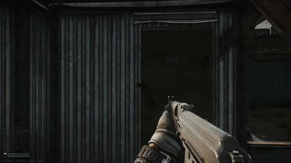 | 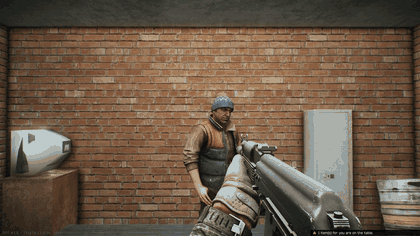 |
| **The hideout is behind a door** | **Build and craft in first person** |
| 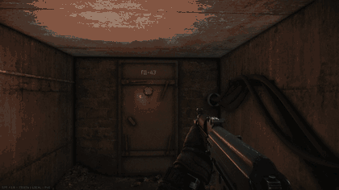 | 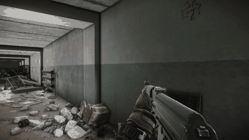 |

## Zero Menu Time {.tabset}

### Overview

- **Traders live on the maps.** Each has a door on one map, and a room of their own behind it. Nothing can follow you in.
- **Trade, quests and mail at the trader.** You pay from what you carry. What you buy, quest rewards and deliveries are laid on the table to pick up by hand.
- **One hideout, three doors** (Customs, Streets, Shoreline). Build stations, craft, run the generator, mod weapons, repair, use the stash, all in first person.
- **One world clock, no raid timer.** Sleep in your bed to pass time, heal and save.
- **A menu of its own**: Continue, Reset, Settings, Guide, Exit, over a live view of your hideout.
- **A guide at start** walks you through all of it in a minute.

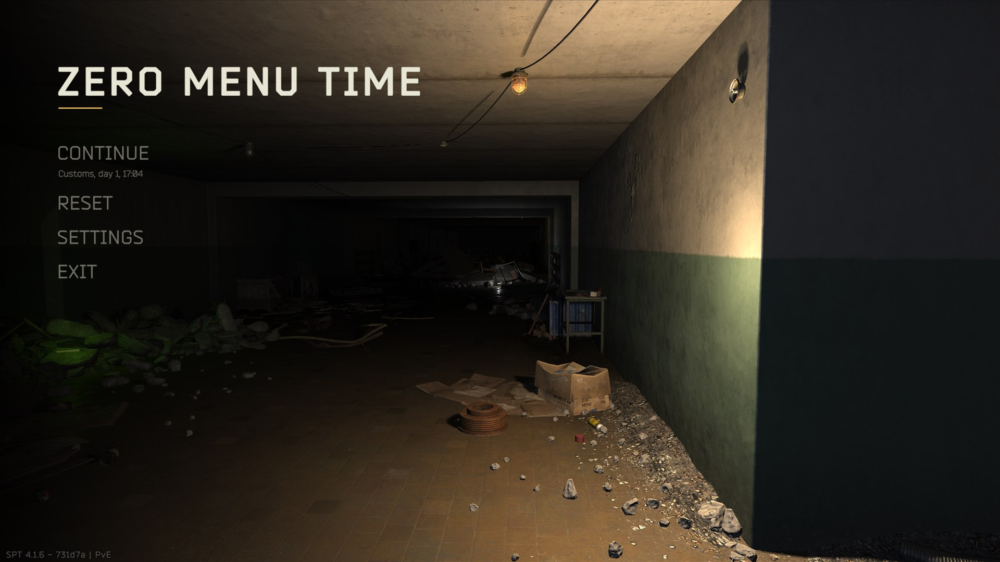

### Traders

- Walk up to a trader's door, look at it and choose **Enter**.
- Inside: **Trade**, **Collect deliveries**, **Save and go to menu**.
- What you buy is **laid on the table**. Quest rewards, the items a quest gives at the start, insurance and other mail arrive there too. Anything you leave waits for your next visit.
- **Sell what you carry or wear.** A slung rifle or a worn helmet comes off you when sold. A pack, rig or case is only offered once empty; the secure container never.
- Quests are taken and handed in in the trader's **Tasks** tab.
- Every trader stocks a few field supplies and the map of the area they stand in.

**Real trader models and voices.** Seven traders can stand in their rooms as their real models and say a line when you start to trade. **The mod does not contain those models or voices**: they belong to the makers of the game. It reads them from **your own installed copy of the 1.0 game**.

- Own it and have it installed? Usually there is nothing to do.
- Models do not show? Press **F12**, open **r2rka1-ZeroMenuTime → Trader models → Folder of the 1.0 game** and enter the folder it is installed in. Needed for a Steam install or a copy moved by hand.
- Do not own it? Nothing is missing: the traders are stand-in figures and do not speak.

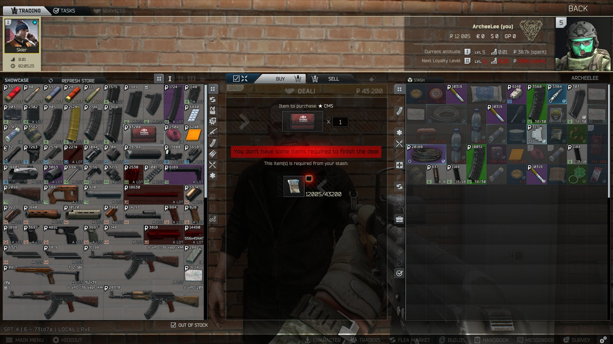

### Hideout

- Behind an existing door on **Customs**, **Streets** and **Shoreline**. All three lead to the same hideout. While you are inside, the raid above stands still.
- Look at a station and open its **window**: what the next level needs, what it can make, how long it takes. Build in any order; you pay the materials.
- **Power**: fuel the Generator and switch it on. Without it the lights are out and crafts wait.
- **Crafting** runs on the world clock, also while you raid or sleep.
- **Workbench**: the game's own weapon modding screen.
- **Repair kits**: right-click a weapon or armour piece → Repair. Weapons need the Workbench, armour the Lavatory.
- **Stash** with a Sort choice. **Rest Space**: sleep, heal, save.
- Bitcoin farm, Water Collector, Solar Power, Scav Case, Cultist Circle, Gym, Shooting Range, Weapon Stand, Place of Fame.

### Where the doors are

Every door is one of the map's own doors. With **[Dynamic Maps](https://sp-mod.com/mod/1431/dynamic-maps)** installed, the doors of the map you are on are also marked on its map (a door with a key; hideout doors in gold).

| Door | Map | Where |
|---|---|---|
| Skier | Customs | The trailer door just north of the Crackhouse, between the Crackhouse and the Repair Shop |
| Hideout | Customs | The ZB-1011 bunker on the east edge, past Warehouse 7: down the stairs, the steel door at the end of the tunnel |
| Prapor | Streets | First floor of the building by the Beluga restaurant on Primorsky Ave., the grey office door |
| Fence | Streets | The red door at the end of the alley between the Post Office and Cardinal Bank |
| Hideout | Streets | Under Prapor's building, the dark red double door at the end of the covered walkway |
| Ragman | Interchange | Parking garage, section C, below Avokado: the white door in the end wall |
| Jaeger | Woods | The stone bunker in the rock face between the Lumber mill and the Crash Site |
| Mechanic | Factory | Basement, by the caged electrical room: the door in the corridor wall |
| Therapist | Ground Zero | TerraGroup building by the Science Offices, 2nd floor, end of the corridor, next to the big 2 |
| Peacekeeper | Shoreline | The gate of checkpoint 11, at the west end of the map |
| Hideout | Shoreline | The red shed next to checkpoint 11, the steel door on its north side |
| Fence | Lighthouse | The drug lab: the shipping container doors behind the plant tables |

**Skier, Customs.** The trailer door just north of the Crackhouse, between the Crackhouse and the Repair Shop.

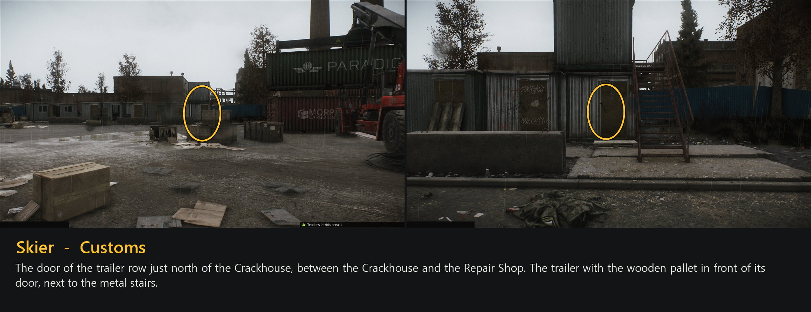

**Hideout, Customs.** The ZB-1011 bunker on the east edge, past Warehouse 7: down the stairs, the steel door at the end of the tunnel.

**Prapor, Streets.** First floor of the building by the Beluga restaurant on Primorsky Ave., the grey office door.

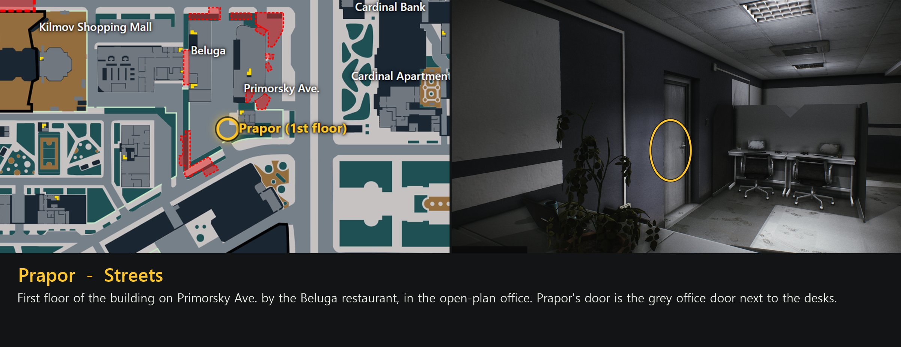

**Fence, Streets.** The red door at the end of the alley between the Post Office and Cardinal Bank.

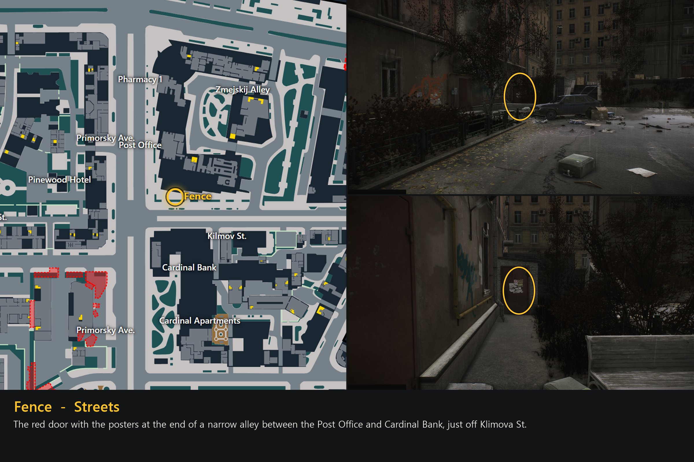

**Hideout, Streets.** Under Prapor's building, the dark red double door at the end of the covered walkway.

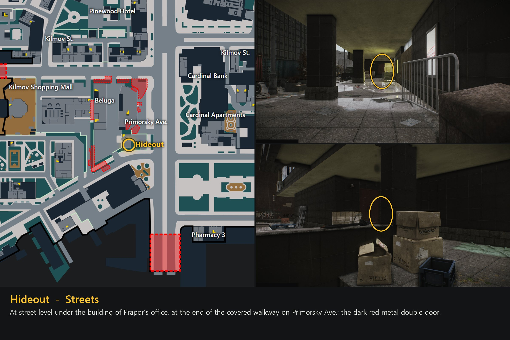

**Ragman, Interchange.** Parking garage, section C, below Avokado: the white door in the end wall.

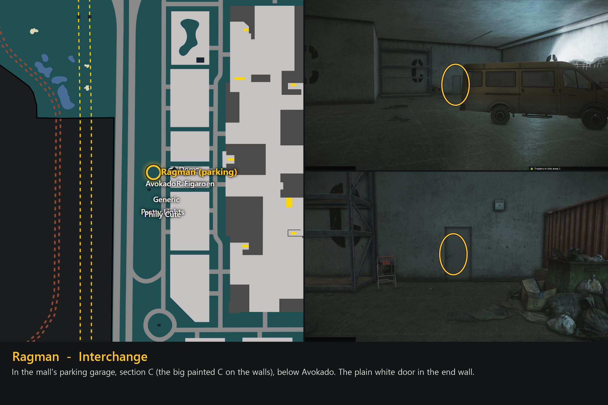

**Jaeger, Woods.** The stone bunker in the rock face between the Lumber mill and the Crash Site.

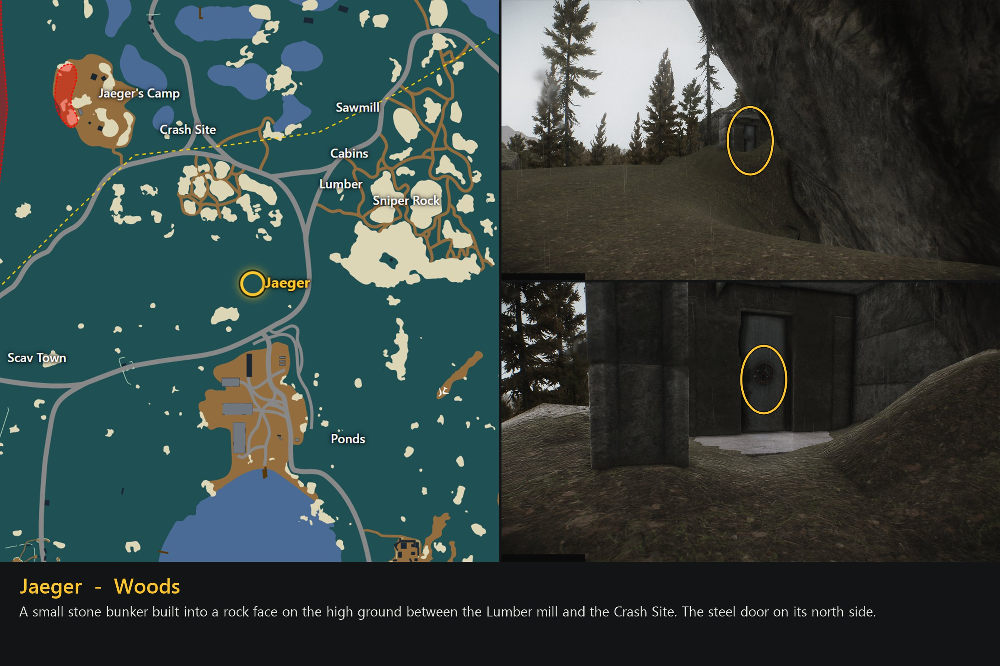

**Mechanic, Factory.** Basement, by the caged electrical room: the door in the corridor wall.

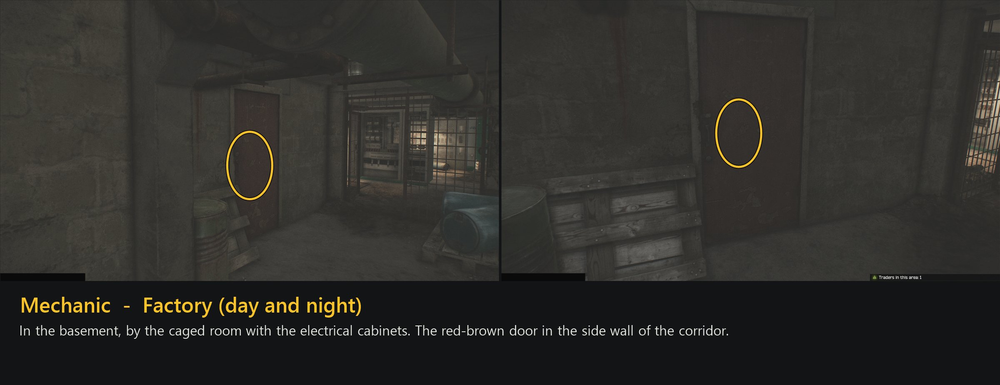

**Therapist, Ground Zero.** TerraGroup building by the Science Offices, 2nd floor, end of the corridor, next to the big 2.

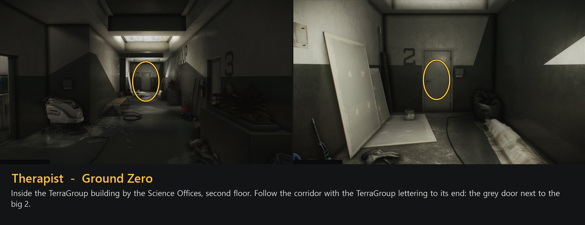

**Peacekeeper, Shoreline.** The gate of checkpoint 11, at the west end of the map.

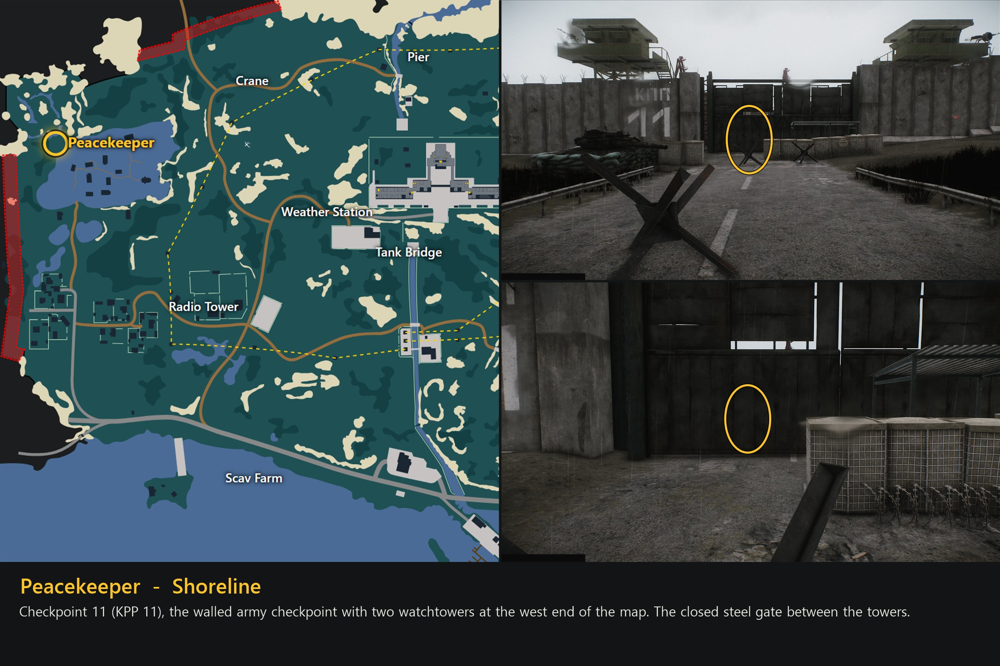

**Hideout, Shoreline.** The red shed next to checkpoint 11, the steel door on its north side.

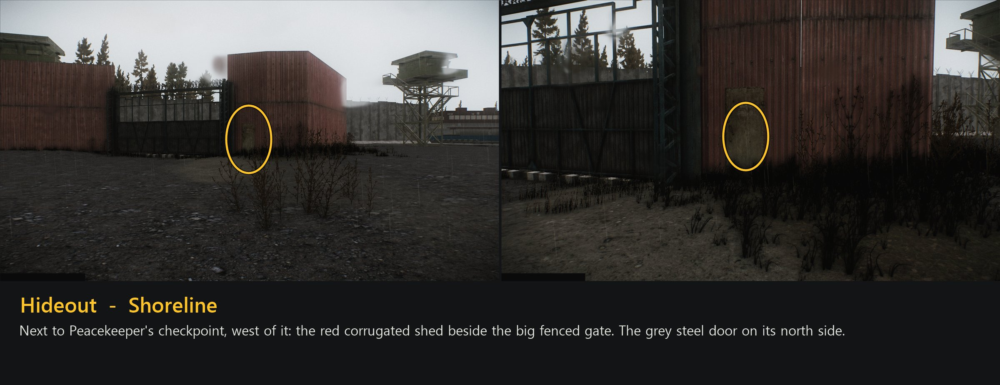

**Fence, Lighthouse.** The drug lab: the shipping container doors behind the plant tables.

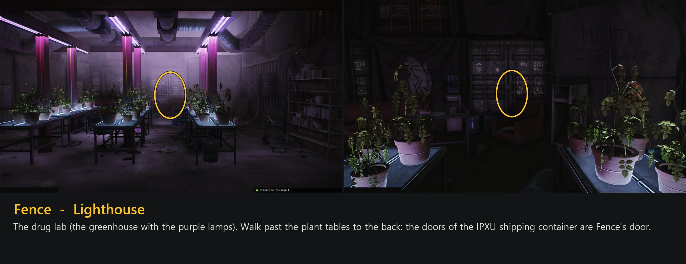

### Install

1. Install SPT 4.1.6 and Vagabond first, and start the game once with Vagabond.
2. Extract the zip **into your SPT folder** (the one that holds the game's `.exe`). It adds `BepInEx/plugins/ZeroMenuTime/` and `SPT_Runtime/user/mods/ZeroMenuTime/`.
   If your SPT server lives in a folder of its own, put the first in the game folder and `ZeroMenuTime` in the server's `user/mods/`, beside Vagabond.
3. Start the server, then the game. A new character starts with a small kit and wakes in the hideout at Customs. With a character you already have, choose **Reset** in the main menu for the same start.

**Fika** (multiplayer) and headless setups are **not supported**.

### Settings

Press **F12** in game and open **r2rka1-ZeroMenuTime**. The ones most asked about:

| Setting | What it does |
|---|---|
| Death → When you die | Keep your save's gear, lose what you carried, or lose everything |
| Trader models → Folder of the 1.0 game | Where your own copy of the 1.0 game is, if it is not found by itself |
| Trader models → Trader voices, Voice volume | Trader lines on starting a trade |
| General → Show the guide at start | The guide over the main menu |
| General → Remove the hideout exits of Vagabond | Switch off Vagabond's exits to its menu hideout |
| No menus → Enabled | Skip result screens and start the next raid by itself |
| Trader rooms → Put traders in rooms | Off: traders stand in the open |

The full table is in the **[README](https://github.com/r2rka1/ZeroMenuTime#settings)**.

### Compatibility and limits

- **Vagabond**: required. **UI Fixes**, **Dynamic Maps**: supported.
- **Fika** and headless: not supported.
- Custom traders are not placed on the maps yet.
- Traders do not repair yet; repair kits do.
- Peacekeeper has no real model or voice and stays a stand-in figure. The voice lines are in Russian.
- More in the **[README](https://github.com/r2rka1/ZeroMenuTime#known-limits)**.
