# Where the traders are, and how to move them

Every trader has a door on one map and a room behind it. From version 2.1 the door is a setting: any trader can be moved to
another door or another map, and a trader added by another mod can be given a door, a kind of room and a figure.

## Moving a trader

1. In game press **F12** and open **r2rka1-ZeroMenuTime**.
2. Find the group **Trader - NAME** (Fence has two: he is on Streets and on Lighthouse).
3. Set **Map**, then go through that map's doors with the arrows at **Door**. A door another trader has says so.
4. The change applies from the next raid.

What to know:

- On the map where Vagabond has the trader, Vagabond's extract for them is kept, so **Save and go to menu** works there as before.
  The door can be any door of that map.
- On any other map the trader has a door and a room but no extract. **Save** still works there (a death or Continue puts you at
  Vagabond's nearest way into that map); **Save and go to menu** is not offered. Vagabond's extract for the trader on their old
  map is switched off, since it leads to nobody.
- The last choice at **Door** is **By Vagabond's extract for them**: the door is put against the nearest wall to the extract, as
  it was before doors could be chosen. Use it if you gave a trader an extract of your own in Vagabond's files.
- If you changed Vagabond's `trader_locations.json` yourself, the mod takes the maps from it once, the first time a raid starts.
- A door of your own, anywhere: stand with your back to it, press **F10**, and put the line from `captured_positions.txt` into
  `doors.json` (see the README). An entry there comes before the setting.

## Traders of other mods

A trader added by another mod is found when the main menu comes up and gets a group of its own, **Custom trader - NAME**. Until
you give them a place they are on no map, and the game tells you so at the menu.

1. Set **Map** (it starts as *Not placed*).
2. Pick a **Door** with the arrows.
3. Choose the **Room**: *Plain*, or furnished like the room of one of the game's traders.
4. Choose the **Figure** that stands in the room: one of the game's traders. A trader of another mod has no model and no voice
   of their own here.
5. Start the next raid on that map. The door is marked on the map (with Dynamic Maps) like the others.

If the other mod, or you, gave the trader an extract in Vagabond's `trader_locations.json`, they are placed on that map by
themselves, with the door by the extract.

Trading, quests, deliveries and waiting work as with any trader. A trader who is locked for your character says so when you try
to trade, as in the menus.

## Playing with friends

The host's settings count for everyone: guests see the traders where the host has them. Everyone needs the same version.

On a headless host the settings are the headless host's own: set them in its `BepInEx/config/com.r2rka1.zeromenutime.cfg`
(the groups are written there after its first raid), with a door's name from the tables below.

## The doors

Each is a door the map already has. None can be opened, none has anything behind it that a player can get to, and none is at a
way out of the map or a transit. They were found by a survey of each map's scenery and then looked at one by one in the game.

Reserve has no doors in this version: the game closed by itself there with a trader's room on the map, and until that is
understood no trader can be put there from the settings.

### Customs

| Door | Where | Position | |
|---|---|---|---|
| `customs-skier` | Shed north of Skier's depot (**Skier** starts here) | 88.95, 1.33, -106.78 |  |
| `customs-00` | Steel door in a steel wall, Customs area, 20 m from Crossroads | -326.87, -0.62, -67.87 | 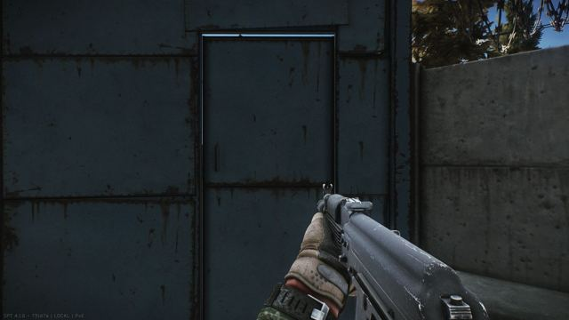 |
| `customs-01` | Red door beside a hanging tarp, Customs area, 65 m from Trailer Park | -314.69, 0.86, -169.57 | 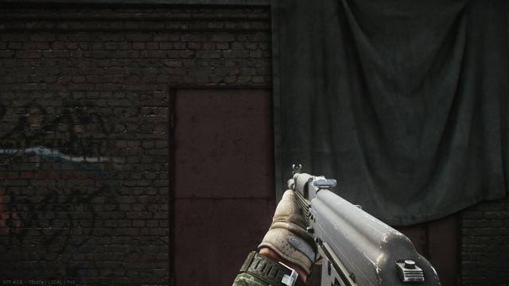 |
| `customs-02` | Garage door 2, Customs area, 35 m from Crossroads | -312.82, 1.01, -115.72 | 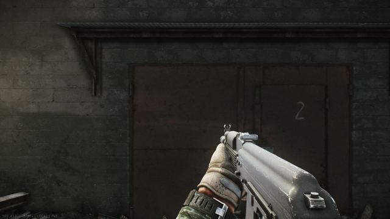 |
| `customs-03` | Garage door 115, Customs area, 55 m from Crossroads | -280.4, 0.87, -98.6 | 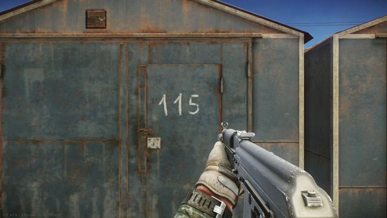 |
| `customs-04` | Garage door 1, under a tarp, Customs area, 65 m from Trailer Park | -272.66, 0.86, -183.25 | 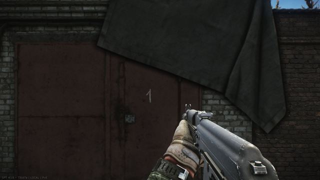 |
| `customs-05` | Shed door with pallets leaning on it, Customs area, 40 m from Trailer Park | -271.73, 0.18, -228.91 | 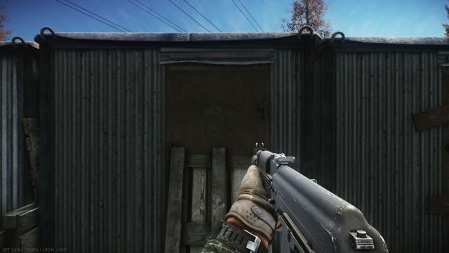 |
| `customs-06` | Garage door 42, Customs area, 70 m from Crossroads | -266.25, 0.8, -66.83 | 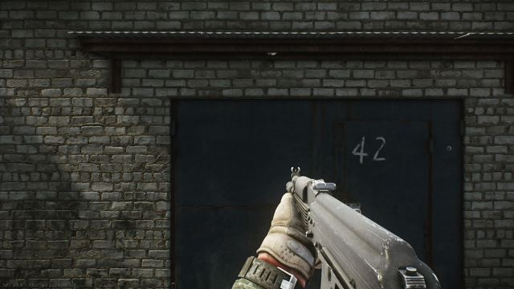 |
| `customs-07` | Garage door 58, Customs area, 90 m from Crossroads | -257.51, 0.87, -131.44 | 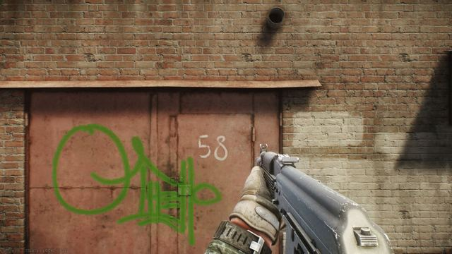 |
| `customs-08` | Red garage door, Wade area, 30 m from RUAF Roadblock | 12.9, 1.11, -116.9 | 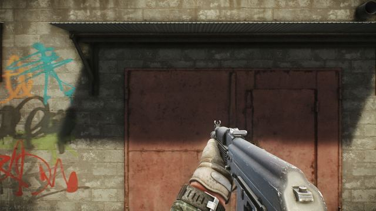 |
| `customs-10` | Shed door, Wade area, 65 m from Boiler Room Basement (Co-op) | 83.48, 1.25, -108.18 | 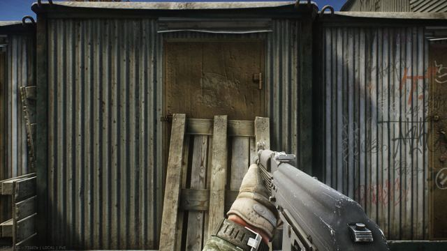 |
| `customs-14` | Blast door, Factory Center area, 160 m from Old Gas Station | 459.09, -2.57, -111.25 | 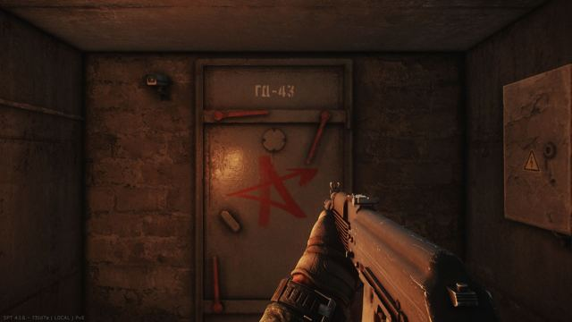 |

### Factory

| Door | Where | Position | |
|---|---|---|---|
| `factory-mechanic` | Wooden door in the basement corridor (**Mechanic** starts here) | 1.09, -2.63, 57.45 |  |
| `factory-01` | Red door in a brick wall, by a barrel, 30 m from Med Tent Gate | 1.52, 0.04, -37.81 | 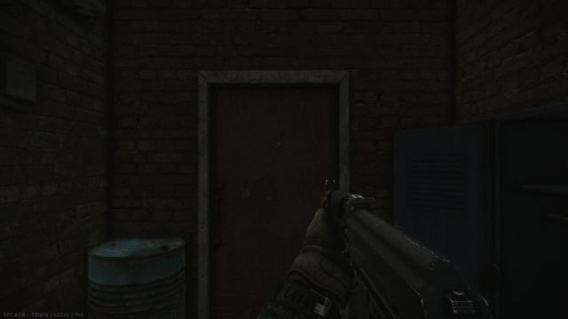 |
| `factory-02` | Steel hatch door, 50 m from Med Tent Gate | 4.47, -3.89, -17.47 | 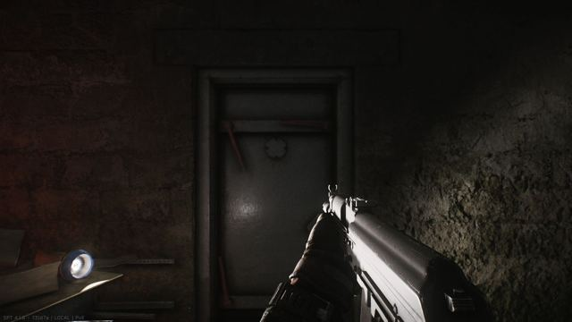 |
| `factory-03` | Steel hatch door by ammunition crates, 45 m from Med Tent Gate | 4.58, -3.89, -25.27 | 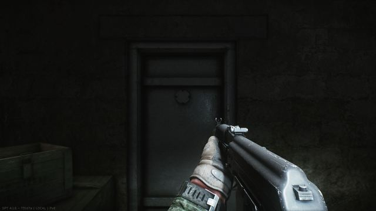 |
| `factory-06` | Wooden door, 50 m from Cellars | 25.16, -2.67, -31.86 | 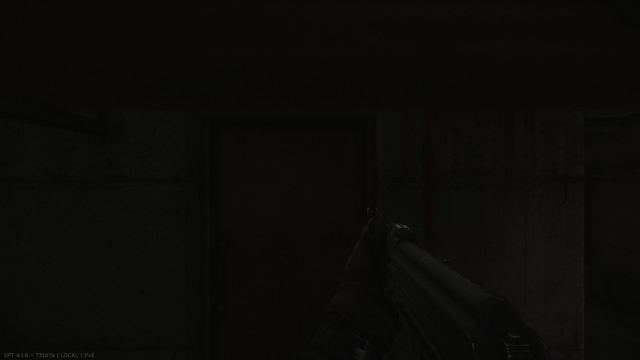 |
| `factory-09` | Red door in a green wall, 30 m from Courtyard Gate | 29.7, 0.99, 40.49 | 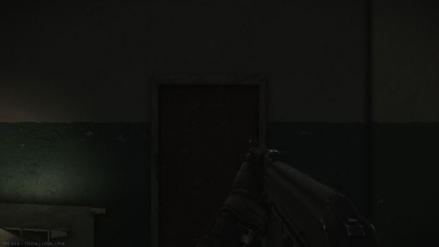 |
| `factory-11` | Red door under the pipes, 45 m from Cellars | 36.98, -2.39, 0.69 | 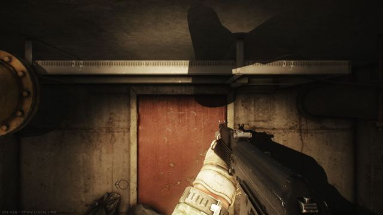 |
| `factory-13` | Blast door, 15 m from Cellars | 57.2, -2.27, -29.91 | 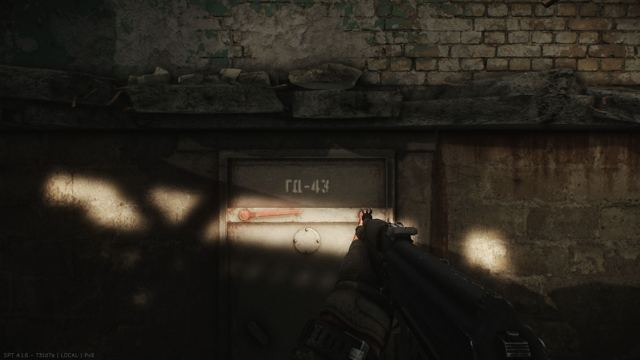 |

### Ground Zero

| Door | Where | Position | |
|---|---|---|---|
| `groundzero-therapist` | Office door, second floor of the TerraGroup building (**Therapist** starts here) | -26.85, 29.72, 92.94 |  |
| `groundzero-00` | Office door with a keypad, by a water cooler, 85 m from Police Cordon V-Ex | -62.85, 24.18, 42.7 | 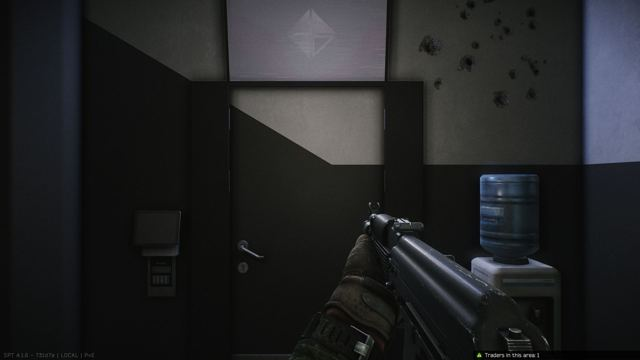 |
| `groundzero-01` | Door between beige wall panels, 75 m from Scav Checkpoint (Co-op) | -26.34, 24.18, -28.39 | 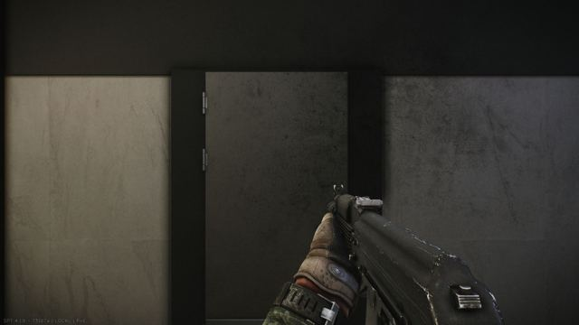 |
| `groundzero-02` | Office door with a keypad, floor 1, 60 m from Police Cordon V-Ex | -24.06, 24.18, 57.47 | 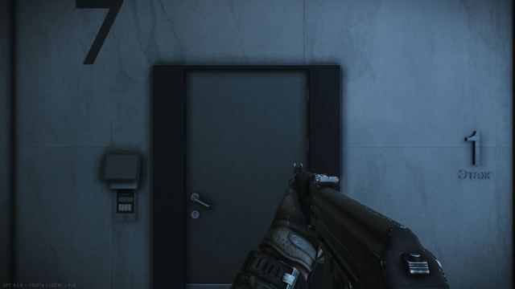 |
| `groundzero-03` | Grey door by a coat stand, 25 m from Police Cordon V-Ex | -22.05, 29.67, 92.67 | 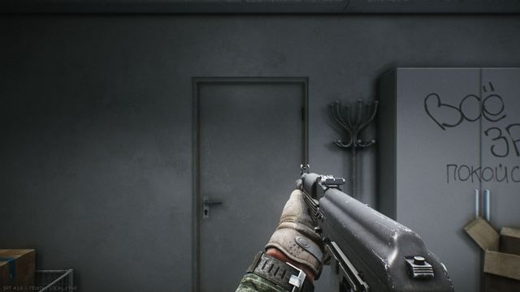 |
| `groundzero-10` | Door with a small sign on it, 140 m from Police Cordon V-Ex | 122.4, 24.4, 127.02 | 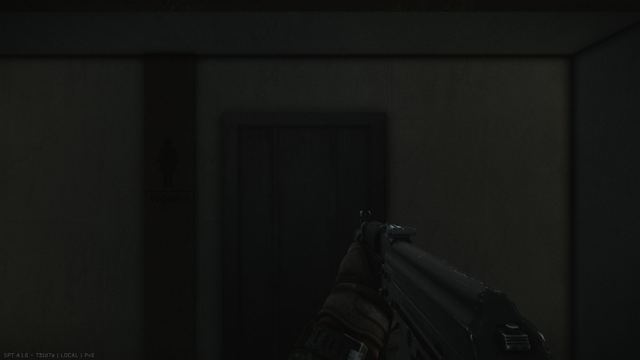 |
| `groundzero-11` | Door in a wall of wooden slats, 90 m from Emercom Checkpoint | 124.65, 22.77, -10.85 | 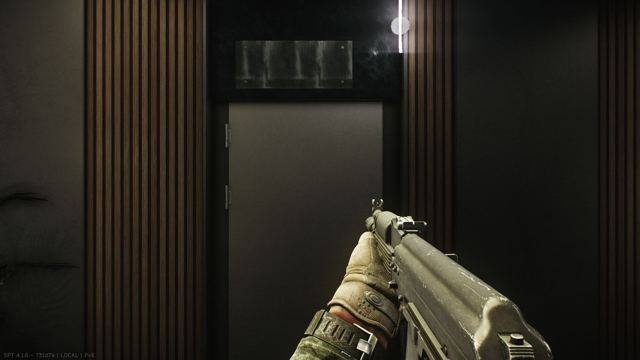 |
| `groundzero-12` | Staff door, 170 m from Nakatani Basement Stairs | 139.17, 23.39, 265.92 | 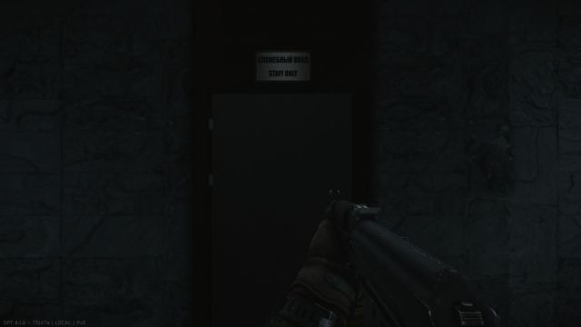 |
| `groundzero-14` | Plain door, 65 m from Mira Ave (Flare) | 165.9, 16.93, -2.27 | 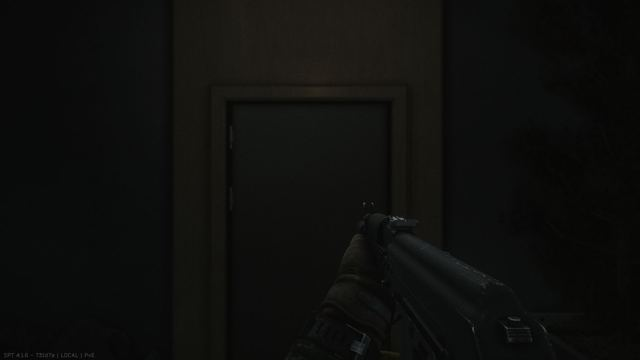 |

### Interchange

| Door | Where | Position | |
|---|---|---|---|
| `interchange-ragman` | Shut door of the mall by Ragman's spot (**Ragman** starts here) | -51.22, 21.33, 46.19 |  |
| `interchange-00` | Rusty door of the substation, by a warning sign, Power Station area, 85 m from Power Station V-Ex | -248.46, 21.33, -284.24 | 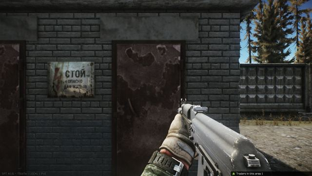 |
| `interchange-05` | Back-room door, OLIPark area, 65 m from Saferoom Exfil | -103.26, 27.09, 80.51 | 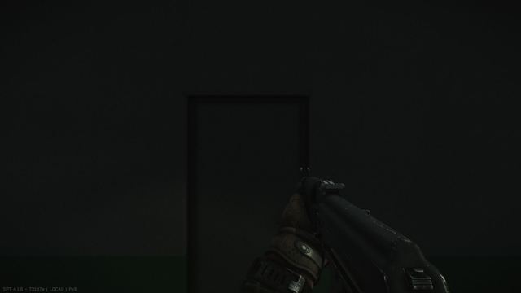 |
| `interchange-06` | Back-room door, Goshan area, 155 m from Saferoom Exfil | -71.3, 27.09, -111.22 | 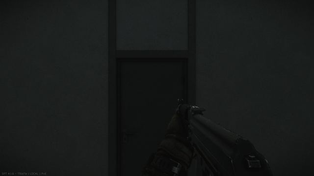 |
| `interchange-07` | Door beside a price board, Goshan area, 65 m from Saferoom Exfil | -57.98, 27.14, -21.13 | 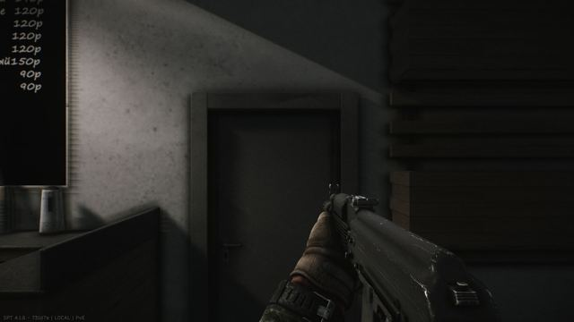 |
| `interchange-08` | Grey door in a white wall, Goshan area, 155 m from Saferoom Exfil | -52.7, 27.09, -111.25 | 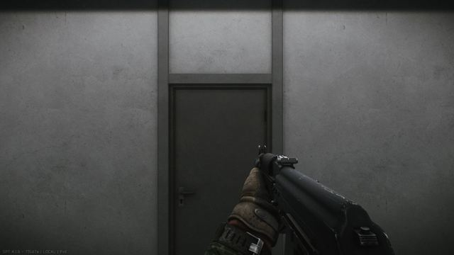 |
| `interchange-10` | Staff door with a sign beside it, IDEA area, 215 m from Saferoom Exfil | -46.42, 27.09, -171.03 | 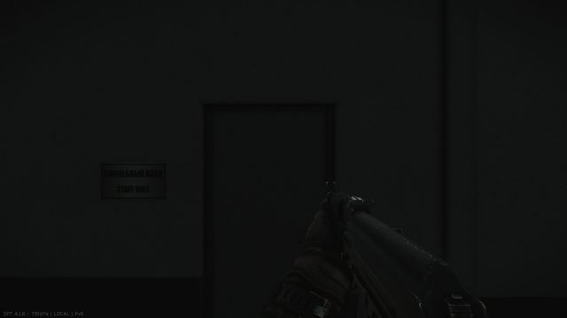 |
| `interchange-13` | Door between shop shelves, OLIPark area, 110 m from Saferoom Exfil | 61.29, 36.58, 39.78 | 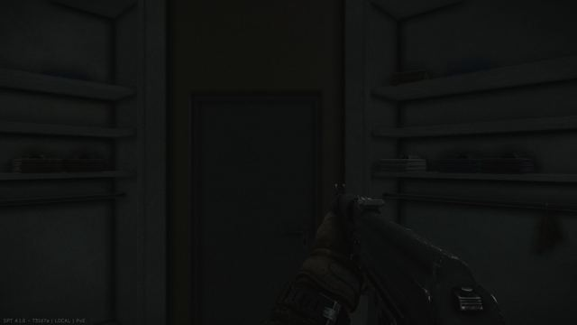 |
| `interchange-14` | Door beside the price signs, Center Bot area, 115 m from Saferoom Exfil | 65.52, 36.58, 29.55 | 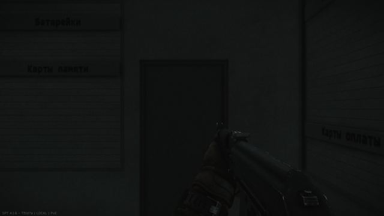 |
| `interchange-15` | Back-room door, OLI area, 145 m from Saferoom Exfil | 84.75, 27.09, 104.67 | 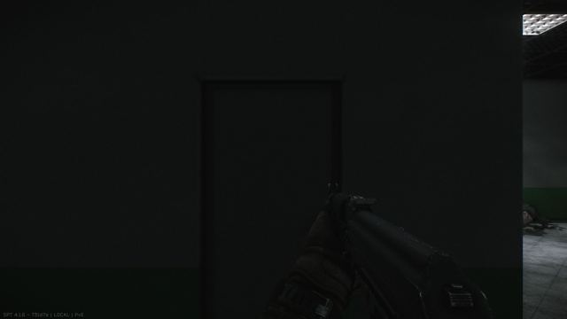 |

### Lighthouse

| Door | Where | Position | |
|---|---|---|---|
| `lighthouse-fence` | Shipping container in the drug lab (**Fence** starts here) | -125.39, 10.6, -839.8 |  |
| `lighthouse-00` | Plank door of a wooden house, Village area, 190 m from Path to Shoreline | -189.58, 12.28, -194.36 | 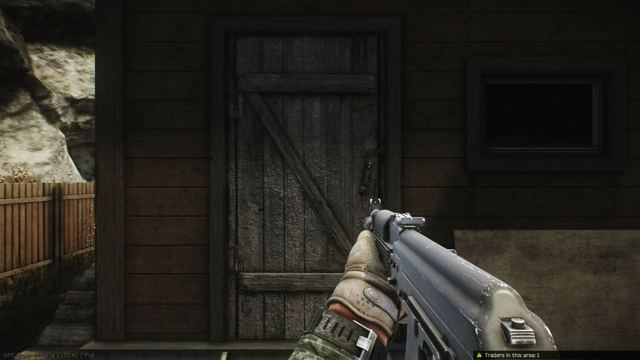 |
| `lighthouse-03` | Steel door in grey siding, 300 m from Road to Military Base V-Ex | -171.24, 4.65, -527.41 | 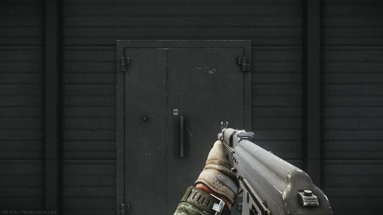 |
| `lighthouse-05` | Arched door of a dark wooden house, 115 m from Mountain Pass | -114.61, 33.36, 94.59 | 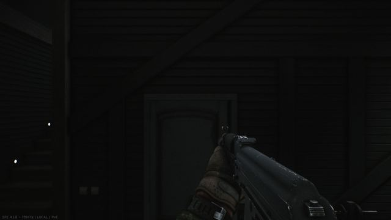 |
| `lighthouse-06` | Blue garage door, Bridge area, 280 m from Mountain Pass | -91.18, 6.04, -274.42 | 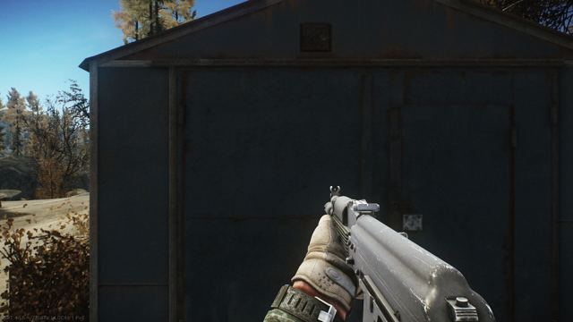 |
| `lighthouse-07` | Panelled door indoors, Chalet area, 125 m from Mountain Pass | -84.91, 18.28, -95.77 | 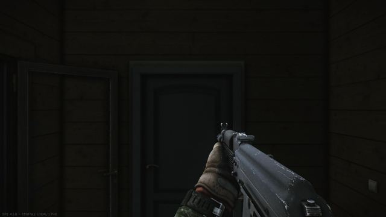 |
| `lighthouse-08` | Panelled door by a fire point, Bridge area, 305 m from Mountain Pass | -75.34, 9.05, -291.14 | 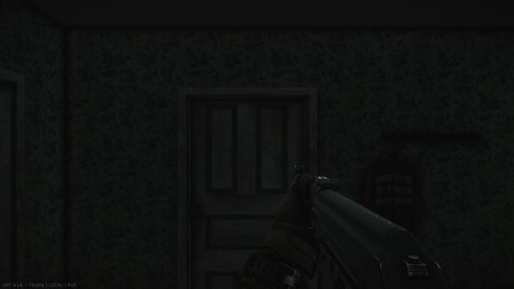 |
| `lighthouse-09` | Boarded-up door of a trailer, Bridge area, 265 m from Mountain Pass | -65.27, 5.71, -248.65 | 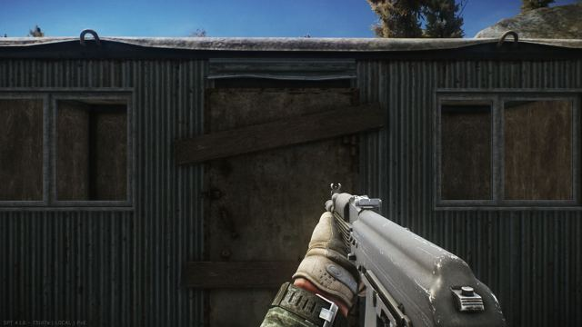 |
| `lighthouse-10` | Grey door in white siding, Treatment Containers area, 195 m from Armored Train | -52.72, 1.65, -689.86 | 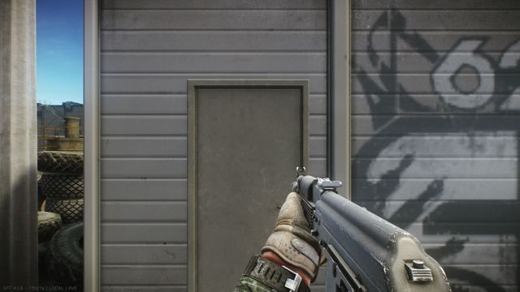 |
| `lighthouse-11` | Door beside a high-voltage box, Roof Beach area, 240 m from Armored Train | 32.46, 4.91, -636.15 | 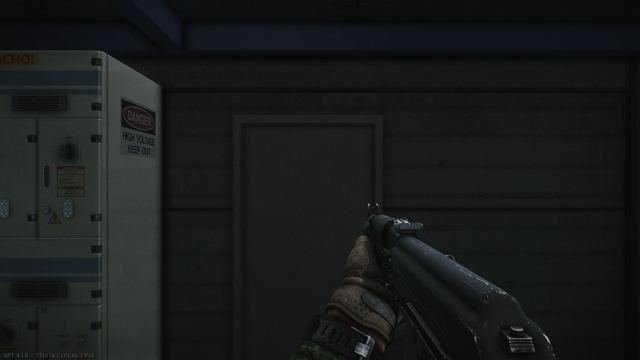 |
| `lighthouse-13` | Rusty shed door under the stairs, Treatment Beach area, 320 m from Armored Train | 47.95, 4.79, -558.53 | 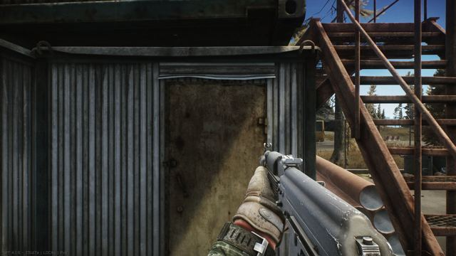 |

### Shoreline

| Door | Where | Position | |
|---|---|---|---|
| `shoreline-peacekeeper` | Steel gate of checkpoint 11 (**Peacekeeper** starts here) | -968.6, -59.6, 378.95 |  |
| `shoreline-01` | Bunker hatch D2, 155 m from Road to North V-Ex | -389.05, -2.86, -386.63 | 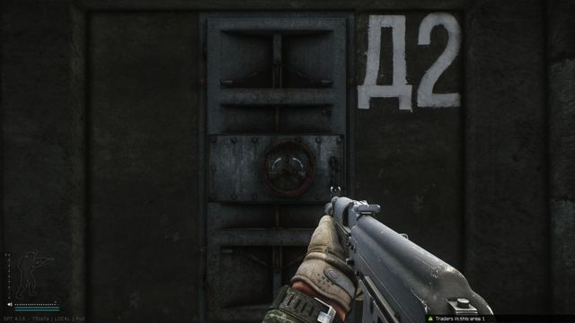 |
| `shoreline-02` | Grey door on a porch, 320 m from Climber's Trail | -361.55, -3.74, -80.01 | 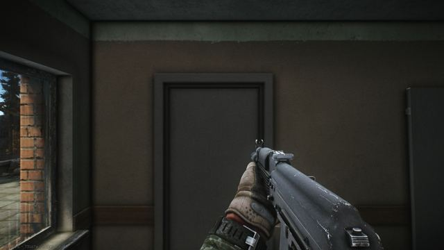 |
| `shoreline-06` | Rusty door of a white brick hut, Power Station area, 365 m from Pier Boat | -248.58, -41.01, 205.29 | 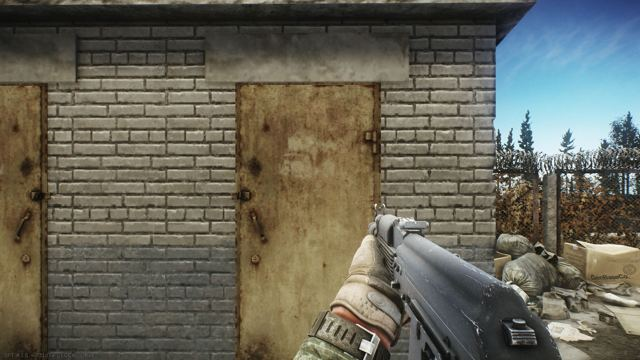 |
| `shoreline-07` | Dark door in a purple wall, 225 m from Climber's Trail | -243.6, -2.49, -138.28 | 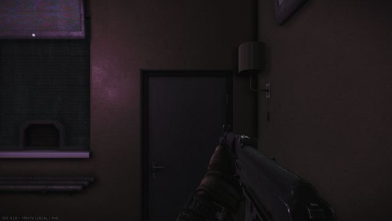 |
| `shoreline-09` | Door on a porch, under two lamps, Bus Station area, 290 m from Climber's Trail | -142.19, -3.74, -80.03 | 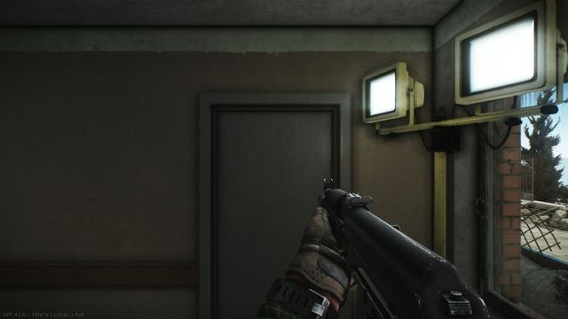 |
| `shoreline-10` | Green panelled door of a cabin, Green Houses area, 350 m from Tunnel | 103.0, -48.41, 102.78 |  |
| `shoreline-11` | Plank door of a log cabin, Green Houses area, 170 m from Tunnel | 273.22, -56.34, 186.83 |  |
| `shoreline-12` | Plank door of a wooden shed, 235 m from Tunnel | 285.32, -56.39, 102.38 |  |
| `shoreline-13` | Plank door of a log cabin, Start Village area, 165 m from Tunnel | 330.13, -56.36, 159.72 |  |

### Streets

| Door | Where | Position | |
|---|---|---|---|
| `streets-prapor` | Wooden door in the corridor at Prapor's (**Prapor** starts here) | -32.50, 6.60, -108.74 |  |
| `streets-fence` | Shut door by Fence's spot (**Fence** starts here) | 73.89, -2.05, 48.81 |  |
| `streets-00` | Plain door indoors, Mvd area, 70 m from Sewer River | -247.85, 2.94, 153.31 |  |
| `streets-02` | Red door between two windows, Factory area, 95 m from Damaged House | -158.44, 2.29, 315.5 |  |
| `streets-04` | Padded door 2 in a stairwell, 75 m from Stylobate Building Elevator | -60.44, 3.19, -145.69 |  |
| `streets-07` | Dark door, 150 m from Collapsed Crane | 65.58, 6.86, 292.01 |  |
| `streets-08` | Dark door by a green pillar, 205 m from Expo Checkpoint | 100.02, 4.06, -273.15 |  |
| `streets-10` | Grey door under the stairs, 140 m from Primorsky Ave Taxi V-Ex | 138.01, 3.06, 452.54 |  |
| `streets-11` | Wooden door 4 in the hotel, 85 m from Expo Checkpoint | 140.19, 3.17, -64.86 |  |
| `streets-12` | Steel door in a concrete wall, 60 m from Collapsed Crane | 217.74, 3.91, 330.59 |  |
| `streets-13` | Red garage door, 70 m from Collapsed Crane | 219.03, 0.39, 200.7 |  |
| `streets-15` | Padded door 2, 60 m from Scav Checkpoint | 271.76, -4.52, 89.91 |  |

### Woods

| Door | Where | Position | |
|---|---|---|---|
| `woods-jaeger` | Steel door of the stone bunker in the rock face (**Jaeger** starts here) | -156.25, 51.2, -272.45 |  |
| `woods-02` | Rusty door of the white brick substation, left, 140 m from UN Roadblock | -614.67, 8.13, 169.13 |  |
| `woods-03` | Rusty door of the white brick substation, right, 140 m from UN Roadblock | -612.41, 8.13, 169.59 |  |
| `woods-05` | Panelled door indoors, 120 m from Bridge V-Ex | -512.64, 15.54, -388.42 |  |
| `woods-06` | Red garage door, 95 m from Bridge V-Ex | -496.19, 14.99, -409.36 |  |
| `woods-07` | Plank door of a log cabin, 100 m from Bridge V-Ex | -458.57, 15.34, -408.24 |  |
